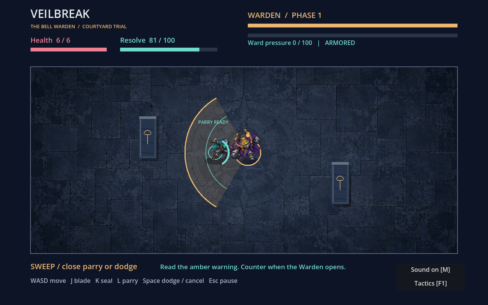
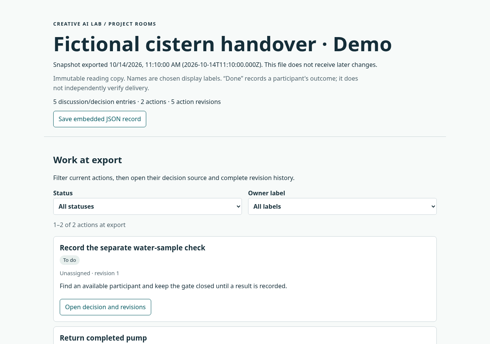

# Creative AI Project HUB

Native games, interactive fiction, literary editions and developer tools by
**[Martin Melcop Neto](https://github.com/MartinFMelcop)**. This portfolio brings
together working prototypes, creative source material and reproducible evidence
from AI-assisted development.

[](https://github.com/MartinFMelcop/Creative_AI_Project_HUB/actions/workflows/lab-checks.yml)

**Start here:** [Explore projects](#portfolio) · [Play or run](#try-a-project) ·
[Read fiction](#read-fiction) · [Review evidence](#engineering-evidence) ·
[Develop](martin-creative-ai-lab-v0.2.0/martin-creative-ai-lab/README.md#develop-and-verify)

## Portfolio

These are the current working samples. Each project page explains its scope,
setup, source and verification; versions identify prototypes or reading editions.

| Project | Experience or workflow | Implementation | Available delivery |
|---|---|---|---|
| **P01 · [Eclipse Fair](martin-creative-ai-lab-v0.2.0/martin-creative-ai-lab/projects/eclipse-fair/README.md)** · 0.5.0 | A market race with rival planning, any-seat solo play and 2–4 local participants | C# / .NET 10, Godot .NET | Standalone Linux x86_64 player and optional compiled project |
| **P03 · [Tokyo 80s: Night Shift](martin-creative-ai-lab-v0.2.0/martin-creative-ai-lab/projects/tokyo80s/README.md)** · 0.4.0 | Two original rhythm stages, sustained notes, timing calibration and phrase rehearsal | JavaScript / Web Audio | Browser game served locally over HTTP |
| **P04 · [A água sob Darsen](martin-creative-ai-lab-v0.2.0/martin-creative-ai-lab/projects/lich-cistern/README.md)** · 0.3.0 | A revised five-scene dark-fantasy story and English translation | Markdown, EPUB 3, PDF; Pandoc / Python production tools | Portuguese and English reading editions, with editable story sources |
| **P05 · [Cinderwatch](martin-creative-ai-lab-v0.2.0/martin-creative-ai-lab/projects/cinderwatch/README.md)** · 0.4.0 | Three tactical rescue encounters with announced intentions, finite supplies and persistent consequences and optional response inspection | C# / Godot .NET | Standalone Linux x86_64 player; editable project retained |
| **P06 · [Veilbreak: The Bell Warden](martin-creative-ai-lab-v0.2.0/martin-creative-ai-lab/projects/veil-arena/README.md)** · 0.6.0 | A two-phase boss trial with committed attacks, timed parries, optional sweep practice, animated art and adaptive audio | GDScript / Godot | Standalone Linux x86_64 player and native source |
| **P10 · [Flood Crossing](martin-creative-ai-lab-v0.2.0/martin-creative-ai-lab/projects/waystone-dialogue/browser/README.md)** · 0.6.0 | A two-day rescue campaign with cargo tradeoffs, relief priorities, noon loans and playable afternoon consequences | JavaScript browser game; Python reference | Browser game with portable replay saves |
| **P11 · [Project Rooms](martin-creative-ai-lab-v0.2.0/martin-creative-ai-lab/projects/realtime-integration-lab/README.md)** · 0.7.0 | Saved discussions, decisions and actions; complete-record search, recovery and portable handovers and complete print reports | Node.js 24 / SQLite / Socket.IO | Local workspace and standalone HTML reading copies |
| **P02 · [EVAL-001](martin-creative-ai-lab-v0.2.0/martin-creative-ai-lab/evaluations/chat-send-buffering/README.md)** · runner 0.2.1 | Export a client-repair task and check returned artifacts against calibrated behavior | Python / Git / Node.js / Chromium | Executable practice-task exporter and checker |

The [project index](martin-creative-ai-lab-v0.2.0/martin-creative-ai-lab/projects/README.md)
and [registry](martin-creative-ai-lab-v0.2.0/martin-creative-ai-lab/registry/projects.json)
also track supporting media work, historical origins and project maturity.

| Native gameplay | Portable project records |
|---|---|
|  |  |
| Veilbreak: recorded combat viewport. | Project Rooms: fictional handover demonstration. |

## Try a project

### Native games

Download the ZIP from its GitHub file page, extract the complete folder and launch
the executable. These players include their engine/runtime; a Linux x86_64 desktop
and compatible graphics/system libraries are required. Project instructions cover
controls, permissions and exact requirements.

- **[Cinderwatch player](martin-creative-ai-lab-v0.2.0/martin-creative-ai-lab/projects/cinderwatch/dist/cinderwatch-linux-0.3.0.zip):** run `./cinderwatch.x86_64` inside the extracted `Cinderwatch/` folder. [Launch guide](martin-creative-ai-lab-v0.2.0/martin-creative-ai-lab/projects/cinderwatch/Native/README.md#play-the-linux-distribution).
- **[Veilbreak player](martin-creative-ai-lab-v0.2.0/martin-creative-ai-lab/projects/veil-arena/dist/veilbreak-linux-0.6.0.zip):** run `./veilbreak.x86_64` inside `Veilbreak/`. [Launch guide](martin-creative-ai-lab-v0.2.0/martin-creative-ai-lab/projects/veil-arena/README.md#play).
- **[Eclipse Fair player](martin-creative-ai-lab-v0.2.0/martin-creative-ai-lab/projects/eclipse-fair/dist/eclipse-fair-linux-0.5.0.zip):** run `./eclipse-fair.x86_64` inside `EclipseFair/`. [Launch guide](martin-creative-ai-lab-v0.2.0/martin-creative-ai-lab/projects/eclipse-fair/Native/README.md#play-the-linux-distribution).

### Browser games

Clone or download this repository. From its root, enter the maintained lab:

```sh
cd martin-creative-ai-lab-v0.2.0/martin-creative-ai-lab
```

With Python 3, serve either delivered browser build. Run one command in a terminal,
open its local address, and stop the server with Ctrl+C when finished.

```sh
# Tokyo 80s — http://127.0.0.1:4173
python3 -m http.server 4173 --bind 127.0.0.1 --directory projects/tokyo80s/dist

# Flood Crossing — http://127.0.0.1:4174
python3 -m http.server 4174 --bind 127.0.0.1 --directory projects/waystone-dialogue/browser/dist
```

Both games run in a modern browser from these static builds. Retained hosted demos
are private and may lag the repository; the project instructions describe current
local play.

### Project Rooms

For a quick inspection, download the [fictional HTML handover](martin-creative-ai-lab-v0.2.0/martin-creative-ai-lab/projects/realtime-integration-lab/examples/cistern-handover.html)
and open it in a browser with JavaScript enabled. It contains its own reading UI
and data, so it works offline. GitHub's source view does not execute the reader.

For the live workspace, use **Node.js 24+** and run from the lab directory:

```sh
cd projects/realtime-integration-lab
npm ci
npm run rooms
```

Open `http://127.0.0.1:3000/studio/`. The [workspace guide](martin-creative-ai-lab-v0.2.0/martin-creative-ai-lab/projects/realtime-integration-lab/README.md#run-project-rooms)
explains persistence, recovery and the trusted local deployment scope.

## Read fiction

**A água sob Darsen / The Water Beneath Darsen** follows a falsified maintenance
record, a failing cistern and the consequences of emergency corpse-binding.
Both languages contain the complete five-scene story.

- **Portuguese:** [EPUB](martin-creative-ai-lab-v0.2.0/martin-creative-ai-lab/projects/lich-cistern/dist/a-agua-sob-darsen-0.3.0.epub) · [A5 PDF](martin-creative-ai-lab-v0.2.0/martin-creative-ai-lab/projects/lich-cistern/dist/a-agua-sob-darsen-0.3.0.pdf) · [Read the source](martin-creative-ai-lab-v0.2.0/martin-creative-ai-lab/projects/lich-cistern/story.md).
- **English:** [EPUB](martin-creative-ai-lab-v0.2.0/martin-creative-ai-lab/projects/lich-cistern/dist/the-water-beneath-darsen-0.3.0.epub) · [A5 PDF](martin-creative-ai-lab-v0.2.0/martin-creative-ai-lab/projects/lich-cistern/dist/the-water-beneath-darsen-0.3.0.pdf) · [Read the source](martin-creative-ai-lab-v0.2.0/martin-creative-ai-lab/projects/lich-cistern/story.en.md).

Download EPUB/PDF files before opening them in a reader. P04 is a separate working
adaptation; the recovered main-book and OVA PDFs are in the [source library](#source-library).

## Engineering evidence

The portfolio demonstrates inspectable engineering and creative production work:

| Capability | Where to inspect it |
|---|---|
| Domain rules, opponent planning, local turn handoff and replayable saves | [Eclipse Fair execution](martin-creative-ai-lab-v0.2.0/martin-creative-ai-lab/evidence/eclipse-fair/LOCAL_RUN.json) |
| Native packaging, state feedback, animation and combat timing | [Cinderwatch release](martin-creative-ai-lab-v0.2.0/martin-creative-ai-lab/evidence/cinderwatch/RELEASE_RUN.json) · [Veilbreak counter route](martin-creative-ai-lab-v0.2.0/martin-creative-ai-lab/evidence/veil-arena/PARRY_RUN.json) |
| Persistent records, idempotent delivery and portable retrieval | [Project Rooms](martin-creative-ai-lab-v0.2.0/martin-creative-ai-lab/projects/realtime-integration-lab/README.md) · [HTML export evidence](martin-creative-ai-lab-v0.2.0/martin-creative-ai-lab/evidence/realtime-chat/PORTABLE_RUN.json) |
| Audio timing, DSP-assisted rehearsal and reproducible creative assets | [Tokyo 80s pitch checks](martin-creative-ai-lab-v0.2.0/martin-creative-ai-lab/evidence/tokyo80s/PITCH_RUN.json) |
| Bilingual editorial production and reader-format conformance | [Darsen edition evidence](martin-creative-ai-lab-v0.2.0/martin-creative-ai-lab/evidence/lich-cistern/REVISION_RUN.json) |
| Controlled evaluation, artifact separation and failure attribution | [EVAL-001 practice workflow](martin-creative-ai-lab-v0.2.0/martin-creative-ai-lab/evaluations/chat-send-buffering/README.md) |

The [automated lab checks](https://github.com/MartinFMelcop/Creative_AI_Project_HUB/actions/workflows/lab-checks.yml)
run on main pushes and pull requests. Project evidence distinguishes executed
checks, simulated inputs and implementing-agent judgments from independent human
feedback. EVAL-001 calibration is a practice-task check, not a model ranking.

## Creative capabilities and source library

**P07 — Visual Generation & Asset Lab** supplies paintings, portrait sheets and
motion atlases already consumed by [Cinderwatch](martin-creative-ai-lab-v0.2.0/martin-creative-ai-lab/projects/cinderwatch/Native/media/provenance.json)
and [Veilbreak](martin-creative-ai-lab-v0.2.0/martin-creative-ai-lab/projects/veil-arena/media/provenance.json).
**P08 — Audio, Poetry & Music Lab** supplies original soundtracks, cues and tempo
derivatives for [Tokyo 80s](martin-creative-ai-lab-v0.2.0/martin-creative-ai-lab/projects/tokyo80s/media/rehearsal-provenance.json)
and the native games. **P09 — AI Delivery & Operations Cases** remains a seed;
its [registry entry](martin-creative-ai-lab-v0.2.0/martin-creative-ai-lab/registry/projects.json)
has no delivered professional case yet.

### Source library

- **[O Lich literary collection](martin-creative-ai-lab-v0.2.0/martin-creative-ai-lab/references/literature/lich/README.md):** ten main books and eight OVAs, 18 unchanged PDFs / 2,407 pages, with per-file hashes and searchable text. Title-page `v0.2.87` and metadata `v0.2.88/noncanonical` labels remain distinct; original ZIP, editable sources and current authority policy are unavailable.
- **[Rave Master reference tree](martin-creative-ai-lab-v0.2.0/martin-creative-ai-lab/references/rave-master/README.md):** 589 readable files from a pinned source snapshot; 140 explicit exclusions. The earlier selected archive remains preserved.
- **[Reference catalog and boundaries](martin-creative-ai-lab-v0.2.0/martin-creative-ai-lab/references/README.md):** distinguish preserved sources, current adaptations and unavailable material. Consult individual provenance and rights records before reuse; this repository has no blanket license for all code, fiction and assets.

## North Star and continuing development

**[North Star](martin-creative-ai-lab-v0.2.0/martin-creative-ai-lab/north-star/README.md)**
is the long-term MMORPG ambition. Its current deliverables are a vision,
capability catalog and bounded research gates; engine selection is open and no
North Star runtime consumer exists. Independent projects retain their own goals,
technology and creative identity.

For development, start with the [lab guide](martin-creative-ai-lab-v0.2.0/martin-creative-ai-lab/README.md),
[current state](martin-creative-ai-lab-v0.2.0/martin-creative-ai-lab/docs/STATE.md)
and [decisions](martin-creative-ai-lab-v0.2.0/martin-creative-ai-lab/docs/DECISIONS.md).
The maintained lab keeps its original `martin-creative-ai-lab-v0.2.0/` wrapper;
that folder name is not the current product version.

Martin provides project goals and authorial direction. AI assistance, source
origins and implementation choices are recorded per project. The [professional
background](martin-creative-ai-lab-v0.2.0/martin-creative-ai-lab/SEED.md#3-base-profissional-de-martin)
is author-reported; these prototypes do not claim client delivery, audience
validation or commercial readiness. [Martin's GitHub profile](https://github.com/MartinFMelcop)
links his public work. For product feedback, use [repository issues](https://github.com/MartinFMelcop/Creative_AI_Project_HUB/issues)
and include the project/version, platform, steps and expected/observed result.
