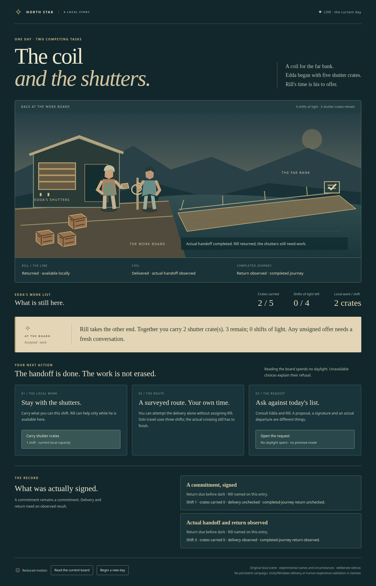
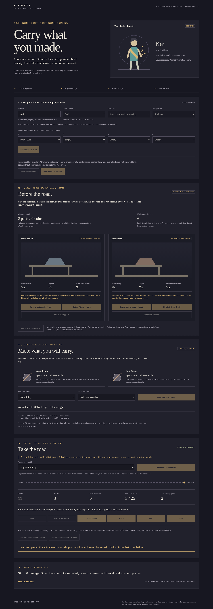
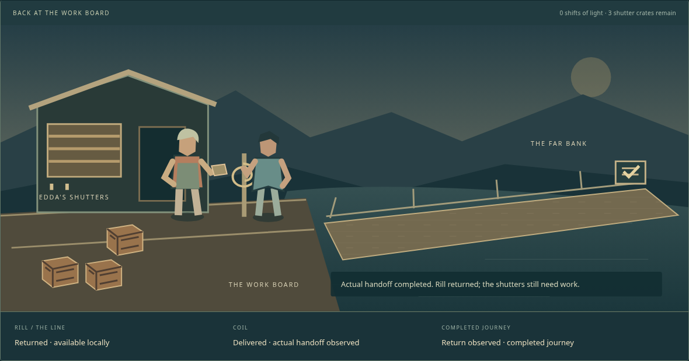

# Creative AI Project HUB

An author-directed **Design-Driven technology portfolio developed with generative AI**,
by **[Martin Melcop Neto](https://github.com/MartinFMelcop)**.

**Eleven research laboratories → tested knowledge and reusable technology →
Virgo Diamond: The North Star → demonstrable portfolio value.**

[North Star](#playable-north-star-increment) · [Laboratories](#applied-research) ·
[Technology](#technology-demonstrations) · [Sources](#knowledge-and-authorial-direction) ·
[Develop and verify](martin-creative-ai-lab-v0.2.0/martin-creative-ai-lab/README.md#develop-and-verify)

## Playable North Star increment

**[Virgo Diamond: The North Star](martin-creative-ai-lab-v0.2.0/martin-creative-ai-lab/north-star/README.md)** is the principal
product: an original MMORPG centered on recognizable character identity through
appearance, builds, classes, specializations, professions, equipment and meaningful choices.
**Unity + C# is the selected primary stack; Windows is the priority player platform,
and Steam is the intended distribution ecosystem.**

### Try the current authored scene — Windows x64 experiment

[**Download The coil and the shutters for Windows**](https://github.com/MartinFMelcop/Creative_AI_Project_HUB/raw/refs/heads/main/martin-creative-ai-lab-v0.2.0/martin-creative-ai-lab/delivery/authored-scene-windows/dist/authored-scene-demo-win-x64.zip) · [Instructions/checksum](martin-creative-ai-lab-v0.2.0/martin-creative-ai-lab/delivery/authored-scene-windows/README.md) · [Actual Windows results](martin-creative-ai-lab-v0.2.0/martin-creative-ai-lab/evidence/windows-recipient/RUN.json)

Extract the complete ZIP. From PowerShell 7 in `AuthoredSceneWindows`, run
`pwsh -NoProfile -File .\run-demo.ps1` and open the printed local URL.
The unchanged C# scene includes its private runtime, notices and recoverable source;
SDK, Node and checkout are unnecessary. Local choices resume outside the package.
Actual automated coverage is **Windows Server 2025 x64 with an administrative token**,
not ordinary-user Windows 10/11 or a physical-device/player assessment. Do not elevate
or bypass execution/HTTP policies to make it run. Unity and Steam remain unexecuted;
Build/Operations remains incomplete under its licensed production acceptance.

### Try the current authored scene — Linux x64

[**Download The coil and the shutters**](https://github.com/MartinFMelcop/Creative_AI_Project_HUB/raw/refs/heads/main/martin-creative-ai-lab-v0.2.0/martin-creative-ai-lab/delivery/authored-scene/dist/authored-scene-demo-linux-x64.zip) · [Instructions and checksums](martin-creative-ai-lab-v0.2.0/martin-creative-ai-lab/delivery/authored-scene/README.md) · [Actual recipient execution](martin-creative-ai-lab-v0.2.0/martin-creative-ai-lab/evidence/request-continuity/RUN.json)

Extract the complete ZIP, enter `AuthoredSceneDemo`, run `./run-demo.sh` and open
its printed local URL. The package includes its private .NET runtime, original assets,
notices and the actual forward source closure; no SDK, Node or checkout is required.
A graphical browser, shell/coreutils and compatible Linux x64 native libraries are
needed. Execution coverage is Debian13 x64 on the recorded environment. It stops after
five minutes by default; Ctrl+C stops it earlier. Accepted choices now survive in
`NorthStarSaves/scene.json` beside the extracted package. Launch again to resume the
same actual scene, commitments and encounter progress. New day retains earlier history;
offline time performs no work or return. Invalid saves refuse launch rather than reset.
This is local continuity, not an account, Steam Cloud or Windows/power-loss guarantee.

Edda's unfinished work, Rill's consent and actual departure/return share one C# owner.
A guided handoff still leaves work unfinished. This original experimental scene is
an executable development demonstration, not Unity/Steam production delivery, approved
world canon or independent player validation. Build/Operations remains incomplete.

### Source experiment — Carry what you made

[**Run the coherent C# field journey**](martin-creative-ai-lab-v0.2.0/martin-creative-ai-lab/north-star/field-journey/README.md) · [Actual execution](martin-creative-ai-lab-v0.2.0/martin-creative-ai-lab/evidence/field-journey/RUN.json)

Confirm one person, acquire a local fitting, spend it assembling actual equipment,
and take that same person through real Crossing encounters. Acquired history stays
true after component use; departure closes the workshop. Leaving too early can leave
the next prepared entry unfunded. This separate SDK-required local experiment has no
save/account and is not in the downloads above. Unity, Windows and human assessment
of this new composition remain unexecuted.

Developer entry points and retained research consumers

| Inspect or execute | Actual scope |
|---|---|
| [Scoped witness opportunity](martin-creative-ai-lab-v0.2.0/martin-creative-ai-lab/north-star/memory-study/README.md) | Actual local help, current support, action-turn expiry and finite fittings; source-memory integration, not human testimony or a new downloadable package. |
| [Original intake baseline](martin-creative-ai-lab-v0.2.0/martin-creative-ai-lab/north-star/intake/README.md) | Separate explicit draft/review/confirmed identity and original prepared journey; preserved unchanged without the new fitting requirement. |
| [C# development foundation](martin-creative-ai-lab-v0.2.0/martin-creative-ai-lab/north-star/csharp/README.md) | Engine-independent progression/crafting domains, connected terminal consumers and checks. No Unity Editor or Windows-player execution is claimed. |
| [Coherent authored C# scene](martin-creative-ai-lab-v0.2.0/martin-creative-ai-lab/north-star/authored-scene/README.md) | Edda's unfinished work, Rill's actual agreement/departure/return and real encounters share one owner; inspected local browser demonstration. |
| [Continuous C# repair and delivery](martin-creative-ai-lab-v0.2.0/martin-creative-ai-lab/north-star/availability-study/README.md) | Actual repair acquisition, paid route, surviving cargo, two real Crossing encounters and observed watering in one C# browser journey. |
| [Source-bound C# combat practice](martin-creative-ai-lab-v0.2.0/martin-creative-ai-lab/north-star/combat-study/README.md) | Actual global-round effects, two finite treatment charges and one preparation-only passive: heavy physical reduction or a single fatal-hit interception; DOT can still defeat rescue. |
| [Original C# adaptive audio](martin-creative-ai-lab-v0.2.0/martin-creative-ai-lab/north-star/csharp/Audio/README.md) | Editable synthesis and consequence-owned cues, aligned musical transport and actual controlled browser playback. |
| [Embodied C# Crossing](martin-creative-ai-lab-v0.2.0/martin-creative-ai-lab/north-star/csharp/Presentation/README.md) | Original avatar, independent outfit/approach and actual protection, advance, damage, refusal and completed encounters; bounded C# browser observer. |
| [Visual C# interaction](martin-creative-ai-lab-v0.2.0/martin-creative-ai-lab/north-star/csharp/Interaction/README.md) | Real timed work, interrupt/rearm, single resource cost and living exit; browser developer view of C# rules. |
| [Original C# narrative scene](martin-creative-ai-lab-v0.2.0/martin-creative-ai-lab/north-star/csharp/Narrative/README.md) | Consent, finite local work and actual crossing outcomes; experimental fiction, local session only. |
| [Playable Godot research baseline](martin-creative-ai-lab-v0.2.0/martin-creative-ai-lab/north-star/prototype/README.md) | An escort and connected return objective with distinct approaches, equipment trade-offs, cosmetic identity and consequential aid. Preserved during migration. |
| [Committed-rush ability bench](martin-creative-ai-lab-v0.2.0/martin-creative-ai-lab/north-star/prototype/abilities/README.md) | Separately runnable short/long movement commitments; source-only experiment with cost, timing and negative controls. |
| [Current capability boundaries](martin-creative-ai-lab-v0.2.0/martin-creative-ai-lab/north-star/capabilities.json) | Origin, adapted, destination and independently validated claims remain distinct. No production MMORPG or Steamworks readiness claim. |

[Captured original C# audio](martin-creative-ai-lab-v0.2.0/martin-creative-ai-lab/evidence/audio-music/crossing-output.wav)
contains declared excerpts of actual Chromium postmix output, including protection,
advance, harm, evasion and outcomes. [Audio execution](martin-creative-ai-lab-v0.2.0/martin-creative-ai-lab/evidence/audio-music/RUN.json)
records signal/lifecycle controls and negative policies. This is a digital graph capture,
not a continuous playthrough, physical listening or validated musical quality.

This image records the actual guided handoff and later local work in one original C# scene.
[Authored execution](martin-creative-ai-lab-v0.2.0/martin-creative-ai-lab/evidence/authored-scene/RUN.json)
retains refusal, withdrawal, solo travel, failed delivery, overdue obligations and lifecycle negatives.
The [separate embodied Crossing image](martin-creative-ai-lab-v0.2.0/martin-creative-ai-lab/evidence/visual-animation/lure.png)
remains available with its independent identity choices. [Visual execution](martin-creative-ai-lab-v0.2.0/martin-creative-ai-lab/evidence/visual-animation/RUN.json)
retains source geometry/state controls, failed policies and actual browser journeys.
The [earlier relay capture](martin-creative-ai-lab-v0.2.0/martin-creative-ai-lab/evidence/input-timing/working.png) and
[retained Godot image](martin-creative-ai-lab-v0.2.0/martin-creative-ai-lab/evidence/north-star-return-gate/guardian-working.png)
remain separate migration evidence. Static event poses do not establish human recognition,
accessibility, artistic approval or continuous animation quality.
[Playable delivery evidence](martin-creative-ai-lab-v0.2.0/martin-creative-ai-lab/evidence/north-star-return-feedback/RUN.json),
[living design](martin-creative-ai-lab-v0.2.0/martin-creative-ai-lab/north-star/DESIGN.md) and
[current implementation state](martin-creative-ai-lab-v0.2.0/martin-creative-ai-lab/docs/STATE.md) identify what was executed and what remains unresolved.
Independent player comprehension, enjoyment, broad hardware coverage and commercial readiness are unvalidated.

## Applied research

All eleven destinations are mandatory. **Operational** means a bounded executable
method and retained results, not a finished research domain. **Incomplete** destinations
have assigned responsibilities and unresolved work; an origin demonstration does not
make its destination laboratory operational.

| Origin | Laboratory destination | Current maturity |
|---|---|---|
| P01 | [Economy & Simulation](martin-creative-ai-lab-v0.2.0/martin-creative-ai-lab/labs/economy-simulation/README.md) | Operational, bounded crafting/conservation research |
| P02 | [AI Evaluation & Quality](martin-creative-ai-lab-v0.2.0/martin-creative-ai-lab/labs/ai-evaluation/README.md) | Operational, bounded independent-context artifact evaluation |
| P03 | [Input, Timing & Interaction](martin-creative-ai-lab-v0.2.0/martin-creative-ai-lab/labs/input-timing/README.md) | Operational, bounded timed-input research |
| P04 | [Narrative & Continuity](martin-creative-ai-lab-v0.2.0/martin-creative-ai-lab/labs/narrative-continuity/README.md) | Operational, bounded consent/causal-state research |
| P05 | [RPG Systems & Progression](martin-creative-ai-lab-v0.2.0/martin-creative-ai-lab/labs/rpg-systems/README.md) | Operational, bounded progression research |
| P06 | [Combat & Responsiveness](martin-creative-ai-lab-v0.2.0/martin-creative-ai-lab/labs/combat-response/README.md) | Operational, bounded native contact research |
| P07 | [Visual Identity & Animation](martin-creative-ai-lab-v0.2.0/martin-creative-ai-lab/labs/visual-animation/README.md) | Operational, bounded registration/state-presentation research |
| P08 | [Audio & Adaptive Music](martin-creative-ai-lab-v0.2.0/martin-creative-ai-lab/labs/audio-music/README.md) | Operational, bounded source/signal/lifecycle research |
| P09 | Build, Release & Operations | Incomplete |
| P10 | [World & Gameplay Systems](martin-creative-ai-lab-v0.2.0/martin-creative-ai-lab/labs/world-gameplay/README.md) | Operational, bounded prepared-action research |
| P11 | [Networking & Persistence](martin-creative-ai-lab-v0.2.0/martin-creative-ai-lab/labs/networking-persistence/README.md) | Operational, bounded local process recovery |

[The laboratory catalog](martin-creative-ai-lab-v0.2.0/martin-creative-ai-lab/labs/origins.json) owns destinations, maturity,
consumers and remaining obligations. [Research entry points](martin-creative-ai-lab-v0.2.0/martin-creative-ai-lab/labs/README.md)
link executable methods and evidence. The [source audit](martin-creative-ai-lab-v0.2.0/martin-creative-ai-lab/labs/legacy-audit.md)
and [complete inventory](martin-creative-ai-lab-v0.2.0/martin-creative-ai-lab/labs/source-inventory.json) distinguish available
implementations, design data and unresolved claims.

[RPG progression evidence](martin-creative-ai-lab-v0.2.0/martin-creative-ai-lab/evidence/rpg-progression/RUN.json) investigates
historical table/runtime agreement and an explicit C# adaptation; historical QA labels
are not accepted as runtime proof. [Combat results](martin-creative-ai-lab-v0.2.0/martin-creative-ai-lab/evidence/combat-response/results.json)
retain successful and failed timing/contact cases. These deterministic studies are
mechanical observations, not independent scientific or player evaluations.

[Selected reputation arithmetic](martin-creative-ai-lab-v0.2.0/martin-creative-ai-lab/north-star/reputation-study/README.md) now has an actual original C# browser consumer with separate store accounts, costly observed returns and a retained small-help failure; historical defaults, hostility and table effects are not imported. [Execution](martin-creative-ai-lab-v0.2.0/martin-creative-ai-lab/evidence/reputation-study/RUN.json) separates source-case agreement and software controls from still unexecuted human, Unity/Windows and Steam assessment.

[Retained-tool and item-identity contracts](martin-creative-ai-lab-v0.2.0/martin-creative-ai-lab/north-star/tooling-study/README.md) now serve an actual original C# consumer: two crafts preserve one gauge, while real Crossing entries consume their outputs and retain failure costs. [Execution](martin-creative-ai-lab-v0.2.0/martin-creative-ai-lab/evidence/tooling-study/RUN.json) preserves malformed source records and unresolved unlock/skill namespaces without importing historical items, quests or effects.

One separately generated first-delivery client passed all 17 checks in a
[calibrated public practice evaluation](martin-creative-ai-lab-v0.2.0/martin-creative-ai-lab/labs/ai-evaluation/README.md).
Baseline defects and missing-browser inconclusiveness remain visible. Fresh agent
context used declared access rules on a shared filesystem; unknown prior exposure
cannot be excluded. This is artifact acceptance, not a model score or new gameplay.

## Technology demonstrations

Historical applications are reusable sources and inspectable demonstrations, without
permanent obligations to ship eleven separate products. Their provenance and actual
consumers govern reuse and retirement.

| Demonstrated capability | Source and execution entry point |
|---|---|
| Resource transactions, policy comparison and recoverable local sessions | [Eclipse Fair C#](martin-creative-ai-lab-v0.2.0/martin-creative-ai-lab/projects/eclipse-fair/README.md) |
| Tactical state, response forecasts and replay-validated recovery | [Cinderwatch C#](martin-creative-ai-lab-v0.2.0/martin-creative-ai-lab/projects/cinderwatch/README.md) |
| Calibrated artifact verification | [Evaluation task and controls](martin-creative-ai-lab-v0.2.0/martin-creative-ai-lab/evaluations/chat-send-buffering/README.md) |
| Audio timing, original music and phrase diagnostics | [Tokyo 80s](martin-creative-ai-lab-v0.2.0/martin-creative-ai-lab/projects/tokyo80s/README.md) |
| Bilingual creative production and reader formats | [Darsen / Lich](martin-creative-ai-lab-v0.2.0/martin-creative-ai-lab/projects/lich-cistern/README.md) |
| Consequential dialogue, consent and world-state replay | [Waystone](martin-creative-ai-lab-v0.2.0/martin-creative-ai-lab/projects/waystone-dialogue/README.md) |
| Durable records, idempotent delivery and portable handovers | [Project Rooms](martin-creative-ai-lab-v0.2.0/martin-creative-ai-lab/projects/realtime-integration-lab/README.md) |

[All origins and media consumers](martin-creative-ai-lab-v0.2.0/martin-creative-ai-lab/projects/README.md) ·
[Verified transfer records](martin-creative-ai-lab-v0.2.0/martin-creative-ai-lab/registry/transfers.json) ·
[Derived findings](martin-creative-ai-lab-v0.2.0/martin-creative-ai-lab/knowledge/README.md)

## Knowledge and authorial direction

The [Engineering, Scientific and Creative Brain library](martin-creative-ai-lab-v0.2.0/martin-creative-ai-lab/brains/README.md)
preserves five supplied source documents and 234 chapters. Specialized agent analyses
use focused retrieval; the documents themselves are neither execution agents nor model
training. Author decisions, creative hypotheses, executed behavior and independent
validation retain different authority.

[Preserved historical sources](martin-creative-ai-lab-v0.2.0/martin-creative-ai-lab/references/README.md) remain distinct from
active consumption: materially relevant capabilities must reach justified integration
or rejection. Unresolved work remains visible. Technical reuse does not import another
work's fictional universe. Consult each source's rights, attribution and provenance;
there is no blanket license for all code, fiction and media.

## Inspect and continue

Start with [the maintained workspace](martin-creative-ai-lab-v0.2.0/martin-creative-ai-lab/README.md),
[current state](martin-creative-ai-lab-v0.2.0/martin-creative-ai-lab/docs/STATE.md) and
[operating instructions](martin-creative-ai-lab-v0.2.0/martin-creative-ai-lab/docs/prompts/CONTINUOUS_DEVELOPMENT.md).
The operating model targets substantive rolling effort of **47% legacy/laboratories,
40% North Star and 13% repository health/presentation**, without per-commit quotas
or invented time measurements. The old outer folder version is historical packaging.

[CI](https://github.com/MartinFMelcop/Creative_AI_Project_HUB/actions/workflows/lab-checks.yml)
reports commit-specific checks. Local execution, publication and CI are separate facts.
[Repository issues](https://github.com/MartinFMelcop/Creative_AI_Project_HUB/issues)
can carry reproducible findings; artifacts do not imply independent human approval or client delivery.

The [combat/status case study](martin-creative-ai-lab-v0.2.0/martin-creative-ai-lab/north-star/combat-study/README.md)
connects preserved formula evidence to an actual original C# encounter and inspected
browser captures. Its global rounds and status counterplay stay separate from the
authored work scene. Neither demonstration is Unity/Windows delivery or player validation.
