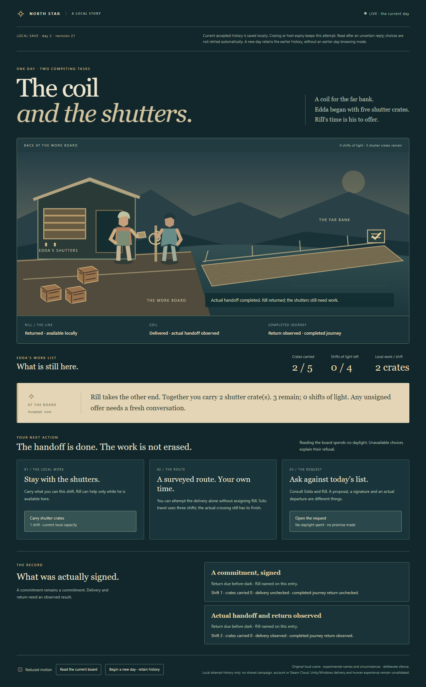

# Windows recipient — The coil and the shutters

This adapts the [same authored scene](../../north-star/authored-scene/README.md) to
an official private .NET10.0.12 Windows x64 runtime. The ten managed application files,
original web assets and recoverable source closure are byte-identical to the existing
[Linux delivery](../authored-scene/README.md). Gameplay and compiled journal identity
are not reimplemented. This is one recipient-platform contribution, not a new scene.

## Run a trusted complete package

[Windows x64 ZIP](dist/authored-scene-demo-win-x64.zip) · [SHA256](dist/SHA256SUMS)

Extract the complete archive, open PowerShell 7 in `AuthoredSceneWindows`, then:

```powershell
pwsh -NoProfile -File .\run-demo.ps1
```

Open the printed `http://127.0.0.1:8768/` in your graphical browser. PowerShell 7 and
Windows x64 are required; SDK, Node, checkout and network are not needed after acquisition.
The host stops after300seconds by default. Optional port/lifetime:
`pwsh -NoProfile -File .\run-demo.ps1 8769 600`. Ctrl+C stops earlier.
The launcher verifies the exact extracted payload and included runtime notices before
launch. Obtain a trusted ZIP and verify its checksum; the manifest is not a signature
or a way to trust arbitrary code.

Do not change machine execution policy, elevate, or modify URL reservations to make
this experimental package run. If local policy or HTTP.sys refuses the listener,
preserve the error and use the source guide or an appropriate supported environment.
Hosted execution records the actual token; it does not establish standard-user access.

Accepted choices commit to `../NorthStarWindowsSaves/scene.json` outside the immutable
payload. Relaunch resumes; corrupt/incompatible saves refuse without resetting.
For a separate directory set `$env:NORTH_STAR_SAVE_DIR` to a fully qualified path.
Stop the process before copying a save and retain its backup. Only the exact unchanged
assembly identities are accepted; no future-version migration is implied. Offline
time, page refresh and promises cannot perform work, complete travel or return Rill.
A guided delivery leaves three crates unfinished. Existing refusal, costs, consent
and actual Crossing owners remain authoritative.

## Evidence and reproduction

[Protocol](../../evidence/windows-recipient/protocol.json) fixes the acceptance and
limits before the first Windows run. The initial published workflow is preparation;
actual results must identify its Windows job and platform. [Actual reviewed execution](../../evidence/windows-recipient/RUN.json) passed 19 controls
on hosted Windows Server 2025 x64 with PowerShell 7.6.7, private runtime 10.0.12 and
Chromium 156.0.8078.4. The token was administrative; ordinary-user Windows, Windows 10/11,
physical devices and human assessment remain unvalidated. No elevation, policy bypass
or URLACL change was made. Build/Operations remains incomplete under the separate
licensed Unity Editor/module and Windows production obligation.

Two distinct Windows staging roots produced exactly the same ZIP as the Linux
adaptation: 35,820,510 bytes, SHA256 `0500d70a6a6c7071f12423fd529c0922830c09d34a312ae46c4f1e562c5aaffb`.
The same exact Linux-generated journal reopened on Windows during actual travel;
this is a tested binary/runtime pair, not automatic future save migration. Source
recovery was freshly executed on Linux and reproduced all ten managed files.

The first Windows checkout failed on long preserved reference filenames before
application execution. Supported Git longpath handling corrected checkout without
renaming, omitting or modifying those originals. A succeeding run was repeated only
to retain compact reviewable results/captures after its original 179 MB artifact exceeded
the supported 32 MiB transfer limit. All actual failures and limits remain recorded;
these executions are not separate substantive units or independent studies.



The official [runtime metadata](https://builds.dotnet.microsoft.com/dotnet/release-metadata/10.0/releases.json)
identifies runtime 10.0.12, [archive URL](https://builds.dotnet.microsoft.com/dotnet/Runtime/10.0.12/dotnet-runtime-10.0.12-win-x64.zip)
and SHA512. `runtime-lock.json` binds all193 runtime files plus the unchanged managed
closure. `package.py` rejects different source, archive or runtime identities.
`check.py` independently checks exact inventory and source binding before extraction.

```sh
python3 delivery/authored-scene-windows/verify.py --runtime-archive /absolute/path/runtime.zip --dotnet /absolute/path/dotnet --output /tmp/windows-preflight-new
```

On Linux this builds twice, inspects and recovers source; it never reports Windows
execution. On Windows, omit `--dotnet` to test the already source-bound delivered
application; the verifier also invokes the actual extracted recipient and Chromium.
The instrument uses pinned Node24.19.0 and the existing locked Playwright dependency;
those are test tools, not recipient requirements. Use a new external output directory.
Cross-environment comparison uses exact payload identity, retaining each ZIP hash
separately because compression implementations may differ.

The actual Linux-generated fixture contains one experimental accepted-command journal
and its observation, generated from the unchanged private-runtime application during
travel. It is not a participant save or an invented completed state. Windows replay
must independently validate it through the real journal owner before portability of
that exact pair can be reported.

## Rights, preservation and limits

The package retains official runtime `LICENSE.txt` and `ThirdPartyNotices.txt`, original
source/BUILDINFO and author-directed experimental scene assets. Martin Melcop Neto
retains creative authority; generative-agent implementation and review are not his
approval of cast/world canon. No blanket commercial license or clearance is granted.
This .NET/browser application is not a Unity player, Steam delivery or production MMORPG.
No independent participant, physical device, comprehension, enjoyment or power-loss
claim follows from automated controls.

The Linux ZIP, prior saves, protected references/Brain files, frozen AI evaluation and
all functioning earlier consumers remain unchanged. Windows shares the actual managed
source/runtime dependencies rather than retiring their duties. Rebuild only if this
platform's actual forward closure changes; do not regenerate historical players. A
future replacement must preserve unique behaviors, source, notices, recovery and save
obligations before retirement. Git history or public URLs alone are insufficient.
