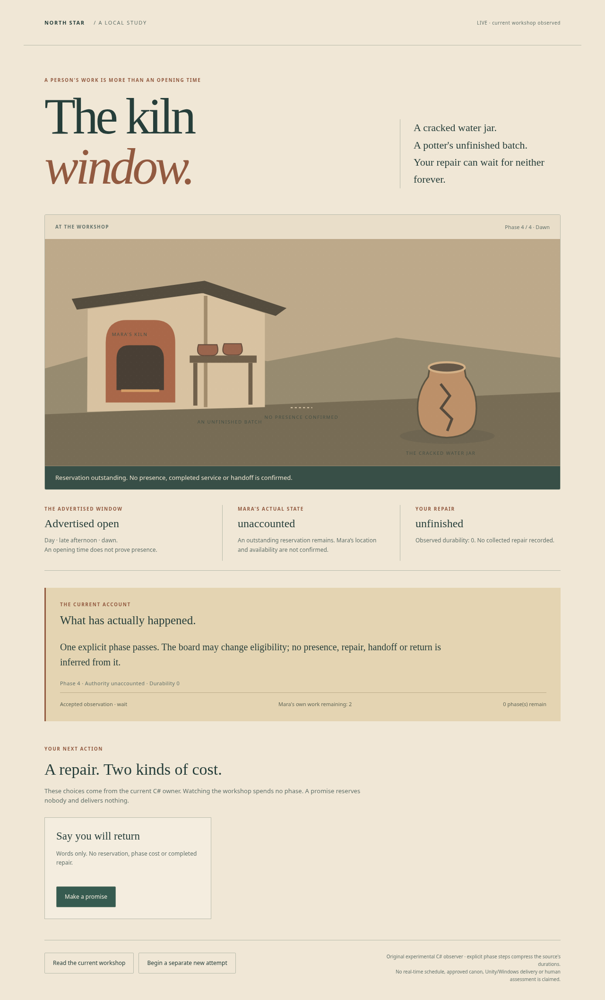

# The kiln window — a person is more than an opening time

One original C# service opportunity separates a posted routine from actual presence,
capacity, work and handoff. Mara has two pots of her own waiting. Your cracked jar can
receive a fired repair (one phase to reserve, two to work, actual collection, durability3)
or an independent temporary patch (two phases, durability1). Leaving a reservation
outstanding can strand the attempt; dawn's advertised opening cannot bring Mara back.

This is original experimental staging, not adopted legacy fiction or approved North Star
canon. Durability is a reported experimental outcome, not a resource consumed by a later
journey or evidence of practical repair quality. Neither the source nor this consumer
provides a continuously simulated village, pathfinding or real-time daily life.

## Execute the consumer

Use the repository SDK10.0.401 pin from `north-star/csharp`. The rules are C#8/netstandard2.1;
the bounded loopback observer is .NET10. From the maintained workspace:

```sh
(cd north-star/csharp && dotnet build ../availability-study/Host/NorthStar.AvailabilityHost.csproj -c Release -m:1 --disable-build-servers)
dotnet north-star/availability-study/Host/bin/Release/net10.0/NorthStar.AvailabilityHost.dll --serve 8769 north-star/availability-study/Host/web --seconds 300
```

Open `http://127.0.0.1:8769/`. The host lasts1–600seconds and can be stopped explicitly.
Substitute an actual SDK executable when it is outside PATH. The browser observes the
C# owner; reads, elapsed wall time and redraw spend no phase. Only explicit accepted
commands change the workshop. A promise neither reserves capacity nor completes work.
The session is ephemeral; restart replaces it. This is a trusted-local observer with
bounded same-origin JSON and an asset allowlist, not a public authenticated service.

`reserve` occupies Mara's capacity; `shape` completes actual reserved work even outside
the advertised window. Ready is not collected. `collect` requires the still-authoritative
ready commitment, including at phase4. `leave` preserves any outstanding reservation
and makes its location unaccounted; `withdraw` cancels reservation without refunding
spent phases and leaves Mara away. Advancing to phase4 cannot restore either state.
A closed service window can still leave enough time for an independent patch. Both
successes preserve her two unfinished pots; no background schedule silently completes them.



## Source contract and deliberate redesign

[The laboratory method](../../labs/world-gameplay/availability/README.md) inspects the
actual27NPC masks and five source phases. Python and compiled C# execute the **same135
literal eligibility cases**, not270independent observations. Historical locations mix
prose, phase ranges and quest/cutscene overrides. Worker masks, home locations, global
resting status and general street heuristics conflict. Those are retained ambiguities,
not a license to choose hidden precedence or claim historical NPC execution.

Only strict phase-mask eligibility and the documented event-over-routine boundary are
adapted. Original North Star commands own presence and service outcomes. The five
explicit phase steps compress source durations; no seconds-to-phase conversion or
literal historical placement parser is adopted. The protected source remains unchanged.
RequestExpedition, Edda/Rill, Crossing, Treatment Line and the downloadable scene are
separate unchanged consumers. No calendar may override their owners or invent returns.

## Verification and limits

```sh
python3 north-star/availability-study/tools/verify.py --dotnet dotnet --output /tmp/kiln-window-new
```

This builds the actual library/host, runs native/source controls, independently checks
native case output through Python, and drives Chromium with the existing locked
Node24.19.0/Playwright instrument. Outputs stay outside maintained sources; a source
identity gate binds actual forward inputs before and after execution. The instrument
retains a real renderer that falsely displays presence for an unaccounted NPC and must
reject it specifically. It does not repeat prior scene, status or media matrices.

Current acceptance passed40native controls,20actual Chromium controls,7HTTP controls
and16instrument regressions. Python and C# passed the same135source cases.

[Executed evidence](../../evidence/npc-availability/RUN.json) owns current outcomes,
identities and captures. The first browser instrument used an obsolete account selector and failed; its actual
failure is retained. An apparently passing browser run was then superseded after image
inspection found that setting SVG `.hidden` did not change rendered visibility. Actual
attribute/CSS rules and computed-style assertions now reject both false text and a
false worker picture independently. The earlier captures remain in the evidence.

Initial equal-time stronger/weaker repairs were found to lack
a temporal tradeoff; shaping now costs two phases. Agent analyses and code/browser
controls are not independent human assessment, balance, comprehension, enjoyment,
art approval or commercial clearance.

Engineering ENG-001/004/015 supported one owner and verifiable temporal contracts;
Science SCI-076/077 separated source identity, software execution and human adequacy;
Creation CRE-005(A),045/048/061(H) preserved voluntary alternatives and uncertain facts.
Reputation arithmetic was a credible executable alternative, but no reputation rules,
factions or effects were imported. Creation parsing remains malformed/unresolved;
another preparation or recovery study would repeat recent beneficiaries.

Unity/C# remains the production direction, Windows-first and Steam-intended. Actual
SDK execution is available; bounded Editor/Hub probes found no usable installation,
and one protected-directory probe was denied. Activation and Windows modules remain
unverified. This .NET/Linux/browser execution does not establish Unity, Windows or Steam
delivery. Build/Operations retains its unchanged incomplete Windows acceptance.
