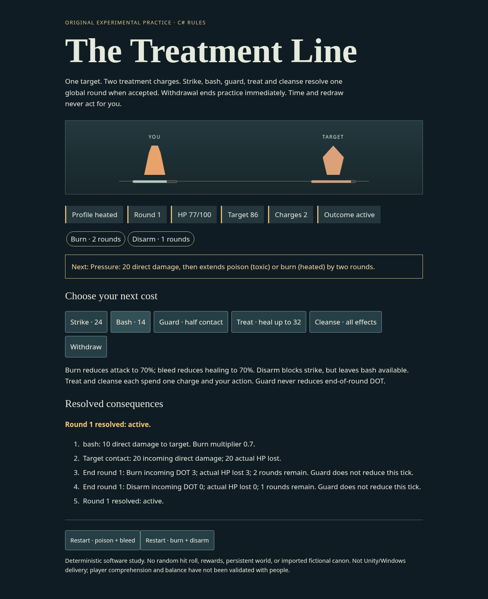

# The Treatment Line — source-bound C# combat practice

One original, playable encounter makes a selected legacy status contract consequential:
poison/bleed or burn/disarm, one global round per accepted combat action, two shared
charges for treatment/cleanse, announced pressure, withdrawal and actual defeat.
This separate experiment leaves Crossing, RequestExpedition and Cinderwatch unchanged.
Its abstract target and presentation are original experimental staging, not approved lore.



## Run the actual consumer

Use the existing SDK10.0.401 pin from `north-star/csharp`; the library is C#8/netstandard2.1,
while this observer/host is .NET10. No external runtime package or browser simulation owns
combat. From the maintained workspace:

```sh
(cd north-star/csharp && dotnet build ../combat-study/Host/NorthStar.CombatStudy.csproj -c Release -m:1 --disable-build-servers)
dotnet north-star/combat-study/Host/bin/Release/net10.0/NorthStar.CombatStudy.dll --serve 8767 north-star/combat-study/Host/web --seconds 300
```

Open `http://127.0.0.1:8767/`. The loopback host expires after the specified 1–600 seconds;
stop it when finished. If SDK is outside PATH, substitute its actual executable path.
Time, redraw and GET do not act. Explicit restart replaces only this in-memory practice.
Unknown receipts pause actions; Reconnect observes the real owner without retrying intent.
The transport is bounded, same-origin JSON, exact-command/schema and static-asset allowlists;
it is not a public/authenticated game service or durable world.

## What was consumed

[The source assay](../../labs/combat-response/status/README.md) stages reviewed preserved
Python/CSV outside protected source and executes 49 vectors across nine components against
both the historical surrogate and the actual compiled C# adapter. Ruby helpers and source
requirements are inspected and hash-bound; Ruby/RMXP execution is absent. No CSV formula
text is executed dynamically. See [strict boundaries](Rules/COMPATIBILITY.md).

The new effect owner applies source percent-of-maximum-HP DOT after the actual player and
living-target actions, then decrements duration once. Reapplication adds duration, not
magnitude. Bleed reduces eligible healing; burn reduces outgoing attack; disarm blocks
strike while leaving bash. Guard halves this encounter's direct contact but never its DOT.
Source hit/application/crit arithmetic is available and tested, but the encounter does
not adopt random hit gates or the full resistance/critical damage pipeline.

Contact 20, target 96, strike 24/bash 14, treatment 32, two charges, pressure cadence, initial
conditions and the solo loss policy are authored study parameters. Final target defeat
still resolves the round's DOT; zero player HP takes priority. No existing source fiction,
full effects/passives, formation, initiative, downstate, breakbar or rewards are imported.

## Actual observations and failures

[Execution record](../../evidence/combat-status/RUN.json) binds actual sources and commands.
43 rules controls, 46 consumer controls, 17 Chromium controls, five HTTP controls and 17
instrument regressions passed. These are distinct software controls, not participants.
The49Python and49C# outcomes are the same49source cases, not 98 independent observations.

- Toxic: four strikes secure the target at HP7, with the final poison tick still paid.
- Heated: cleanse, strike, guard, strike, strike, treat, strike secure it at HP10.
- Earlier treatment in the proposed six-action heated route loses at HP0/target7.
  Both the initial failed assertion and full losing route remain retained; tuning was unchanged.
- Constant guarding loses in both profiles. Cleansing costs an action/charge and pressure
  can reapply after that action; it is not invulnerability.
- Independent review executed a tiny positive denominator defect beyond the 49 historical
  cases. Epsilon selection was corrected; both exact input replay and new controls pass.
- Independent Engineering also reproduced a false passing result accepted by the new
  verifier. Actual/Got comparison against source expectations now rejects that fabricated
  result, with finite values, exact identities and component tolerances checked.
- A separate actual renderer that fabricates full HP after guarded DOT is detected by the
  HP assertion. An accepted command with a lost response remains quarantined until GET.

This protocol evolved during authored implementation; it was not externally preregistered.
Winning routes establish existence and the retained counterexample, not optimal play,
balance, fairness, comprehension, meaningful identity or enjoyment. Captures were inspected
for actual state correspondence; this is not independent player or author acceptance.

## Reproduce and production boundary

```sh
python3 labs/combat-response/status/test_instrument.py
python3 north-star/combat-study/tools/verify.py --dotnet dotnet --output /tmp/combat-status-new
```

Requires the existing locked Node24.19.0/Playwright instrument and actual Chromium
(`CHROMIUM_PATH` may select the installed binary); use a fresh output directory outside
the maintained workspace. The verifier inventories actual forward project dependencies,
checks SDK, builds, runs native/source/browser controls, retains command diagnostics and
rejects source changes during execution. It does not rerun unrelated prior study matrices.

Unity/C# remains selected, Windows-first and Steam-intended. Actual Editor, activation,
Windows module/player and Steam delivery remain unverified/unexecuted. The official
[activation methods](https://docs.unity3d.com/6000.0/Documentation/Manual/LicenseActivationMethods.html)
and [Windows requirements](https://docs.unity3d.com/6000.0/Documentation/Manual/windows-requirements-and-compatibility.html)
were consulted; neither supplies an installed licensed toolchain. No Editor patch or
commercial clearance is inferred. This .NET/Linux/browser consumer is not that delivery.

## Selected passive preparation and actual effects

The same Treatment Line now offers explicit **New practice preparation**, one passive
slot and typed Light/Heavy context. Begin creates that actual encounter. The existing
restart buttons still start active None/light trials; existing None outcomes remain
regression obligations. Round0 in an active encounter is not preparation. Active or
ended equip refuses; only an explicit new practice discards the ephemeral old trial
and creates fresh resources/usage. This is not a live swap, account refund or save.

Lining reduces typed physical DIRECT contact10% only with Heavy. Guard applies first;
remaining integer damage rounds away from zero. Light, other direct categories and DOT
receive no Lining reduction. Heavy/Light here is a condition, without a complete armor
stat/cost system. Last Thread intercepts one eligible fatal DIRECT hit at1HP per
encounter; it never resurrects0HP, never intercepts DOT and cannot protect from later
DOT in the SAME round. Raw reduction differs from actual HP loss/HP loss avoided.

Source prose supplies these selected patterns, not their complete operational order,
DOT classification or rounding. Study availability does not grant historical level6/9,
class/gender/rarity/learning eligibility. Original display names avoid importing that
fiction. Rogue20% and Knight-while-uncontrolled alternatives remain incompatible and
unimplemented. The one scalar source UI assignment is not a complete effect provider.

Actual toxic sequence `strike,strike,strike,cleanse,strike` can secure at1HP with Last
Thread while None dies on its fourth action. `strike,strike,strike,bash` can trigger
rescue yet die to DOT that same round. These are fixed software policies, not optimality,
balance, necessity or player preference. Explicit controls show the selected passive,
armor condition, direct-hit accounting and used rescue without turning rescue into
victory or invulnerability.

Reproduce the source assay, native mechanics, new actual browser flow and affected
old regressions using a new external output directory:

```bash
python3 north-star/combat-study/tools/passive-verify.py --dotnet dotnet --output /tmp/passive-new-output
```

[Selected method](../../labs/combat-response/passives/README.md) and
[actual evidence](../../evidence/passive-response/RUN.json) preserve the scope, negatives,
original producer and limits. Rules remain C#8/netstandard2.1; Host is .NET10/Linux/browser,
not Unity, new Windows/Steam delivery, human validation or final source canon.

## Optional paid response practice — original bounded policy

Prepare responses explicitly, then Begin. Commit spends one shared treatment charge
before its 48-base weapon strike resolves (existing burn/disarm still apply). The target
commits its single ward above that cast. Release lets the ward counter it without
refund; Break ward spends another shared charge and resolves before the ward. Each
whole chain resolves one existing contact/global-DOT round, never one round per item.
Pending casts lock unrelated actions; reads and elapsed time cannot resolve them.

The same charges also fund treatment/cleanse. These costs and the one ward are original
experimental parameters, not a recovered skill or balanced player finding. Classic
practice remains available. Explicit fresh preparation/restart is a new ephemeral
trial, not a refund or rearm within the old encounter. Textual resolution logs record
actual order; no graphical stack widget is introduced. Only STK-001/002 and CST-001's
narrow queue/LIFO/paid-cast contracts are adapted; full triggers/slot priorities/AGI,
state-based battle rules, fizzle and ultimate cooldowns remain unresolved.

```bash
python3 north-star/combat-study/tools/response-verify.py --dotnet dotnet --output /tmp/response-practice-new
```
