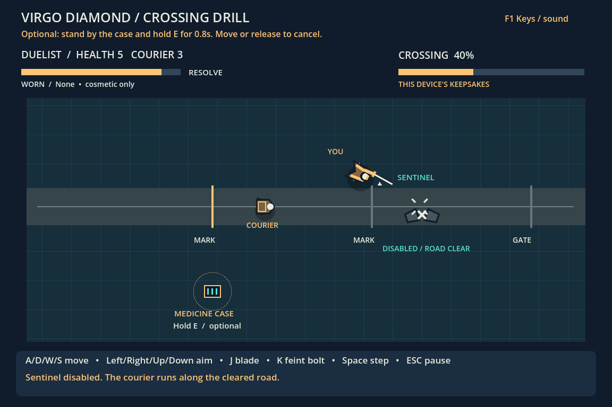
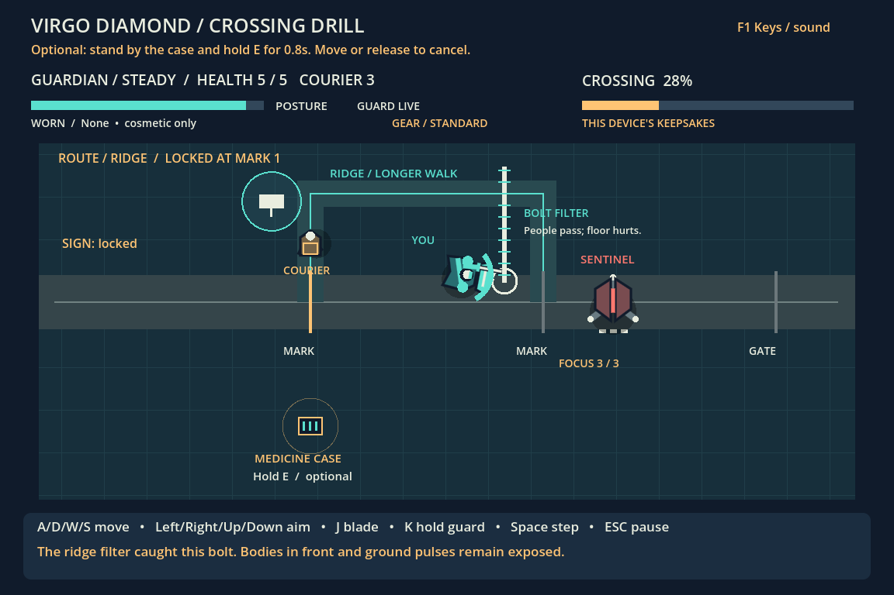
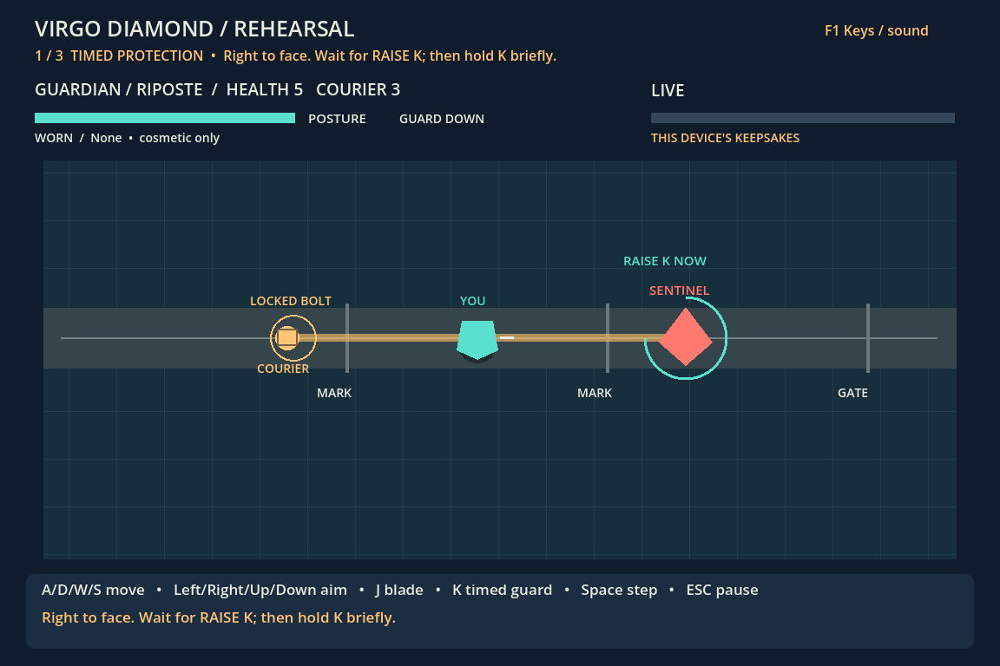
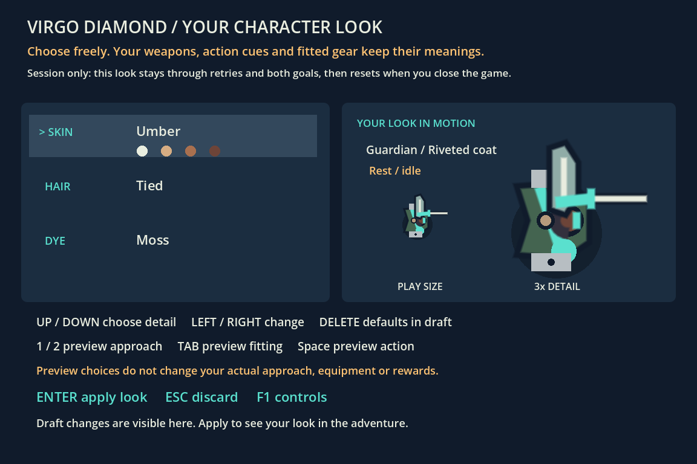
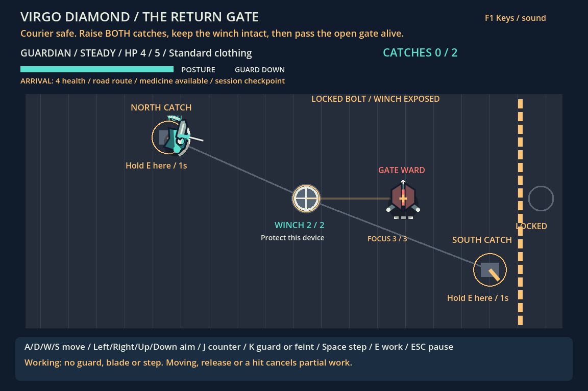
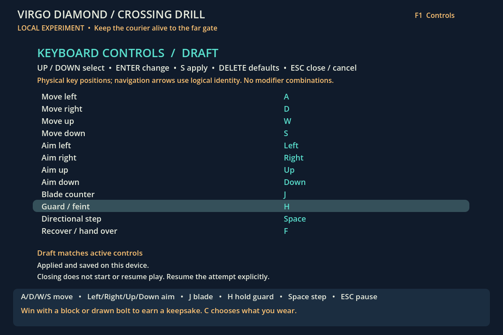
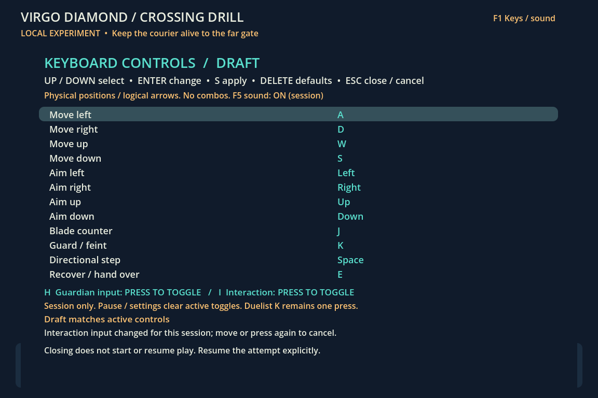

# Crossing Drill — local character prototype

The first executable **Virgo Diamond** destination consumer: a short original courier
crossing with two experimental approaches. The current increment is local DEVELOPMENT,
not a production MMORPG, final class system or final engine selection. See the
[living design record](../DESIGN.md) for author direction, experimental decisions,
revisions and rejected alternatives.

## Play

**Linux x86_64:** download the [standalone ZIP](dist/crossing-drill-linux-0.1.0.zip)
and its [SHA-256 checksum](dist/crossing-drill-linux-0.1.0.zip.sha256), extract the
complete `CrossingDrill` folder, then open `crossing-drill.x86_64` or run
`./crossing-drill.x86_64`. Keep its PCK beside it. No Godot editor, SDK, Python,
Node, source checkout or network is required to play. The roughly 27 MB ZIP bundles
the official runtime and its notices. Your Linux desktop still needs system
libraries and OpenGL 3.3. Other platforms and broad hardware compatibility are
unverified. If extraction loses executable permission: `chmod +x crossing-drill.x86_64`.
See the [included player guide](PLAYER_README.txt).

**Developer alternatives:** use **Godot 4.6.3 standard** (tested on Linux x86_64).
No SDK, npm packages, external assets or remote service. From the maintained lab:

```bash
godot --path north-star/prototype
# Or download the small engine-dependent PCK and run:
godot --main-pack north-star/prototype/dist/crossing-drill.pck
```

The small [PCK](dist/crossing-drill.pck) includes the source consumer and native
checks without Godot. The editable project, PCK and exported Linux player were
executed separately; the export includes Godot-generated resource/cache metadata.
It is not interchangeable with an arbitrary raw PCK/runtime pairing.

Choose **1 Guardian** or **2 Duelist**. Press **T** for optional rehearsal, or
**Enter** to skip directly to the crossing. Keep the courier alive until it reaches
the far gate (30 simulated seconds at walking pace, shorter after shutdown). Losing all five player health or all three
courier health loses the attempt. Both approaches can complete the goal.

- **WASD:** move. **Arrow keys:** aim by logical navigation key; WASD uses physical positions.
  Facing otherwise follows movement.
- **Guardian / hold K:** intercept the amber line between sentinel and courier,
  facing the sentinel. Guard starts after 60ms, locks facing, slows movement and
  drains posture. Impact costs another 22. Release K to recover and turn.
- **Duelist / press K:** during a bolt warning within the range ring, draw the
  locked aim onto your current position (16 resolve). Leave that line; redirecting
  across the courier can still hit it first.
- **Space:** directional paid step (25 resolve), with recovery. It grants **no
  invulnerability**. Walking is also a valid way out of a locked threat.
- **J:** a close blade counter during OPEN, within 130px, removes one focus plate
  and buys time before the next threat. Armor/short range gives no counter. Guard/step commitment can
  reject the request; it still needs 12 resolve. The OPEN ring shows the actual
  counter range, and its label shows the remaining window in seconds.
- **Red ground pulse:** leave the marked circle. A shield cannot block the floor.
- **Esc:** pause/resume. Focus loss pauses. **R** while paused abandons the attempt
  for approach selection; at the result screen it returns to selection. **Enter**
  retries from a clean state. The current attempt's result is session-only; earned
  cosmetic keepsakes use the separate local profile described below.

Pause and result screens retain the last contact's explanation and an actionable
tip, even after transient warnings or the final loss message replace the live
feedback. Diagnosis distinguishes facing, guard startup, insufficient posture,
unguarded contact, courier first contact, and pulse/bolt outcomes.

## Hold the line or disable its source

Protection remains a complete route: keep responding until the courier reaches the
gate, without requiring a blade counter. Optionally approach during OPEN and land
**three valid J counters** to break the sentinel's three focus plates. The existing
130px reach, 12 resolve/posture cost, guard/step commitment and blade recovery still
apply. Closed armor and rejected/out-of-range requests cannot remove a plate.

The world shows remaining focus as three small plates and **FOCUS n / 3**. The third
counter collapses the core, clears OPEN/queued attacks and permanently stops this
attempt's bolts and floor pulses. The feint range disappears with its unavailable
source. The courier then **runs at 56px/s**, twice the normal 28px/s. Shutdown is not
completion: the courier and player must still be alive at the gate. No new kill loot,
keepsake, profile format, stat tier, approved boss lore or final class system exists.

This makes timing/position an optional offensive investment. The medicine case remains
available; an executed Duelist route disables first, then recovers and hands it back.
The courier never waits, and faster travel also leaves less time for unfinished tasks.
Carrying is still not delivery. Retry/abandon restores three plates and normal pace;
practice supplies only its original isolated opening, never carried core damage.

[Matched execution](../../evidence/north-star-sentinel-resolution/RUN.json) retains
actual source/PCK and prior unmodified-PCK controls. The fixed protective routes finish
at tick 1800 (30s); tested offensive routes finish at tick 1648 (~27.47s) for both
Guardian techniques and 1262 (~21.03s) for Duelist. These policies are not optimal play,
class-balance evidence, preference or human comprehension. Guardian's tested protective
route ends with courier 2/3 versus 3/3 offensive; Duelist has 3/3 in both. No universal
benefit or unavoidable class disadvantage follows from this one policy comparison.



## A route chosen in the world

The normal crossing starts on **ROAD**, the original 840px direct path. Walk to the
sign at (350,260) and press **E** once to signal **RIDGE**. A fresh press revises the
choice until the courier reaches MARK 1 (x=400); the displayed lock then prevents
replanning. The sign uses the remapped interaction key, not a new binding. Holding
interaction never cycles the choice, and pause/rehearsal cannot signal it.

Ridge is an actual 1,120px path: the courier turns north, crosses the upper lane and
returns to the road. It adds 280px at the same walking/running speed. Its raised
projectile filter catches only finite bolt segments crossing its upper extent.
People pass through it; a nearer player or courier still owns contact, and ground
pulses still hurt. A catch has its own flash/explanation, grants no personal block,
OPEN, keepsake or immunity, and is counted separately on the result screen.

The warning predicts the courier's real path around corners before locking its aim;
it is not a homing shot. Progress counts remaining path length, including vertical
travel. Death and gate arrival keep their original ownership; choosing Ridge and
doing nothing still loses. Retry starts on Road with no previous catches. Medicine,
workshop, guard techniques and cosmetics retain their existing contracts.

```bash
python3 north-star/prototype/tools/verify_routes.py --output /tmp/routes.json --compare evidence/north-star-route-choice/results.json
python3 north-star/prototype/tools/verify_routes_input.py --output /tmp/route-input
godot --path north-star/prototype --script res://tests/render_routes.gd -- /tmp/route-frames
```

The latter two require a display; the input runner owns a bounded Xorg dummy window
and synthetic XTest keys on Linux. It checks actual navigation, nearby choice,
revision, pause/outside rejection and reset, not a full OS-input escort. The native
runner separately executes 49 controls and four complete fixed routes in source/PCK.
See [execution and images](../../evidence/north-star-route-choice/RUN.json).
Those policies take longer on Ridge and catch 2/1 bolts for Guardian/Duelist;
they demonstrate feasible consequences, not a universally safer route, optimal play,
participant preference or a validated adventure. Temporary names/geometry are
experimental, not approved geography or final class/canon decisions.



## Optional roadside workshop

From approach selection, **F2** opens a safe native preparation space. Walk to a
bench with the current movement bindings and hold the interaction key (**E** by
default) for one continuous second inside its **46px** ring. The labeled action
**MAKE & WEAR** spends one fitting blank exactly once and equips the result:

| Clothing | Player health | Walk / guarded walk | Step distance |
|---|---:|---:|---:|
| Standard, including skipping the workshop | 5 | 250 / 85 px/s | Baseline |
| Riveted coat | 6 | 200 / 68 px/s | 20% less |
| Trail wrap | 4 | 300 / 102 px/s | 20% more |

Both approaches can make either piece. Shoulder plates versus split cloth strips
remain visible in the actual crossing. Neither changes courier health/speed, threat
schedule, guard windows, energy costs, invulnerability, keepsakes or reward eligibility.
Move or release interaction to cancel unfinished work without spending the blank.
After completion, release before another action; holding does not replace confirmation.
**C** in the workshop recycles the fitting, restores standard clothing and returns the
single blank. It is an explicit reversible choice, not material duplication.

**Enter** leaves for a fresh normal crossing with the worn piece. **R** returns to
selection. **Esc** pauses/resumes workshop work; focus loss or settings cancels partial
work and pauses. Enter from pause resumes without departing. Resuming/settings never
supplies a held interaction. The courier/threat clock has not started in this space.
F2 cannot open it during play, crossing pause or rehearsal; abandon with R from pause
or result before changing gear. Retry keeps the fitting, but there is no live swap or
healing through re-equipping. Isolated rehearsal remains standard clothing.

Crafting state is session-only. A new process starts standard with one blank; no
keepsake/control schema or disk save changes. This is an experimental two-recipe
craft-to-build consumer, not a profession career, economy, inventory, persistent power,
final item/class approval or independently validated player preference.

```bash
python3 north-star/prototype/tools/verify_workshop.py --output /tmp/workshop.json --compare evidence/north-star-linux-player/workshop.json
# Optional actual Linux XTest window navigation; requires Xorg/dummy and local sockets:
python3 north-star/prototype/tools/verify_workshop_input.py --output /tmp/workshop-input
```

[Executed source/PCK controls and native images](../../evidence/north-star-workshop/RUN.json)
include all six standard/coat/wrap approach routes, health/movement/step consequences,
undo, duplicate rejection and interruption. Fixed policies are not balance evidence;
synthetic OS input and agent image inspection are not independent human experience.

## Guardian technique choice

On selection, choose **1 Guardian**, then **Tab** to switch between **Steady**
(default) and **Riposte**. This changes the selected technique, not a cosmetic mark.
The choice carries through **T** rehearsal, retry and clean crossing. It is locked
during a crossing, pause or rehearsal; **R** abandons the attempt for selection.
It remains a session choice and resets to Steady on a new process. Tab can still be
remapped to a gameplay action; its selection function exists only on the title.
Duelist keeps its existing draw/mobility behavior and never inherits a guard technique.

| Technique | Actual defense | Counter opportunity | Cost / exposure |
|---|---|---|---|
| Steady | Frontal held guard becomes live after 60ms and remains eligible while held with posture | 1.0s OPEN after a block | Holding drains posture, locks facing and slows movement. |
| Riposte | Frontal guard is eligible only at age 60–300ms after raising | 1.6s OPEN after a timed block | Raising early expires before impact; raising late still fails startup. Release before raising again. |

Both retain 22 posture per impact,12 posture/second holding, the same facing cone,
130px counter reach and 12 resolve/posture strike cost. Neither protects the floor or
grants step immunity. Riposte is an opt-in timing trade-off, not a superior stat tier.
Its warning ring and **RAISE K NOW** cue expose the incoming timing; **GUARD STARTUP /
LIVE / STALE** and the shield arc show the actual guard state. Text follows remapped
ability keys. A failed exercise retains the cause and recovery tip. The third exercise
still supplies its ordinary 1.0s opening; rehearsal never grants a carried buff.

This is one bounded experimental choice within Guardian, not approval of the Creative
Brain's candidate specialization trees, a full talent/build system or balance proof.
Keepsake eligibility and the optional medicine request are unchanged. A recorded late
counter at 1.2s succeeds after Riposte and fails after Steady, demonstrating the actual
opportunity difference. Fixed routes show feasibility, not optimal play or preference.



## Talk to the courier

After a real escort arrival, **F4** opens a quiet optional conversation. **Tab** asks
about the crossing: actual route, blocks/drawn bolts, sentinel shutdown and medicine
ownership determine the courier's account. A recovered case is not reported as delivered.
This conversation does not add a post-arrival medicine handoff.

The courier offers one repair strip. Choose **1** to bind a wound (+1 prepared health,
capped by the fitted limit), **2** to brace the return winch (3 starting integrity
instead of 2), or **3** to leave it with the courier (no aid). Full-health dressing is
unavailable. There is no default selection: a number only drafts the response;
**Enter** confirms it once. **Esc** closes/discards an unconfirmed choice. Settings
or focus interruption clears pending confirmation. Reopening preserves an agreement.

**F2** departs for the return goal. Only confirmed aid applies, and it does not rewrite
the completed escort health or earn another keepsake. Retry restores that prepared
checkpoint; it never stacks another strip. Direct F2 continuation without conversation
is still valid, and keeping the strip has the same mechanical journey as skipping.
A new crossing or abandonment clears the agreement. No account, reputation meter,
persistent quest or source fictional universe is added.

```bash
python3 north-star/prototype/tools/verify_conversation.py --output /tmp/conversation.json --compare evidence/north-star-linux-player/conversation.json
# Optional Linux XTest keys after a fixture completes the actual escort:
python3 north-star/prototype/tools/verify_conversation_display.py --output /tmp/conversation-display
```

[Bounded execution and inspected scenes](../../evidence/north-star-courier-conversation/RUN.json)
separate native controls/eight matched two-goal journeys and real synthetic OS keys
from independent player interpretation. The conversation adapts P10's gated-choice
and fact-owned-response method in new native code; it does not import its characters,
setting, implementation or full emotional/work-shift systems. Its repair fiction and
creative significance remain experimental.

## Choose your character look

On approach selection, **F3** opens skin, hair and cloth-dye choices independent of
approach, fitted gear and earned marks. **Up/Down** selects a detail; **Left/Right**
cycles it. **Enter** applies; **Esc** discards; **Delete** puts defaults in the draft.
You can revise the look by returning to selection. No unlock, payment or stat change.

The preview uses the same player drawing at play size and 3x detail. **1/2** previews
either approach; **Tab** previews supported fittings; **Space** cycles real rest/walk,
response, paid step and blade samples. These preview choices do not change your real
approach, equipment or rewards. F1 controls remain available. Focus loss pauses the
sample; an editor key resumes. The blade sample hits closed armor, not a fake counter.

Applied expression reaches the workshop, rehearsal, replay and both adventure goals.
Role accents, weapons, functional gear and action warnings remain distinct. **Local
continuity:** Enter applies and saves free choices on this device, without earning a
mark. Escape discards and Delete changes only the draft. F5 retries the already applied
look while retaining an open draft. Loading/cancelling never rewrites profile bytes;
control remaps remain a separate file.
The editor is available on selection, without live appearance changes or combat timing.



```bash
python3 north-star/prototype/tools/verify_look.py --output /tmp/look.json --compare evidence/north-star-linux-player/look.json
python3 north-star/prototype/tools/verify_look_display.py --baseline /path/to/prior.pck --output /tmp/look-display
```

The optional Linux display runner owns bounded Xorg/engine processes and needs the
same display dependencies as other native input tools. It compares source/PCK scenes,
can require prior default gameplay pixels, and uses real keys for draft/cancel/apply,
play, unknown-file repair and fresh-process retention. [Evidence](../../evidence/north-star-appearance-continuity/RUN.json)
distinguishes these controls from agent art judgment and missing independent player
recognition, preference or accessibility. The creator is limited experimental expression,
not final class/people canon, a complete character system or proof of the identity fantasy.

### Verify local appearance continuity

```bash
python3 north-star/prototype/tools/verify_appearance.py --output /tmp/appearance.json --compare evidence/north-star-linux-player/appearance.json
```

52 native migration/failure controls run in source and PCK. Twenty actual engine
processes apply/read/cancel/earn/play both goals/reset defaults/read, with exact
source/PCK outcomes. Invalid versions, numeric types, fields and write/replacement
failure preserve primary bytes; restored mark selection and pending look are tested
independently. This does not prove power-loss durability or concurrent-writer safety.

## An optional second playable goal

After winning the real escort, press **F2** to continue to the return gate, or **Enter**
to replay the original crossing. Your actual remaining health/energy, approach, Guardian
technique and fitting carry. Route/medicine facts remain visible, without invented room
bonuses. The courier stays safe; this is a separate ward and protected winch.

Raise **both catches**: walk inside a handle's 32px ring, then hold the applied interaction
key (default **E**) for one second. Single-press interaction mode also applies. Work
excludes guard, blade and step; movement, release or being hit cancels partial work.
Pause, focus loss and controls interrupt/disarm it. Threats keep running. Protect the
winch with actual interception/redirection, or disable the ward through three existing
close counters before working. A broken winch or dead character loses. Raised catches
open a real movement boundary; **walk through the exit alive** to finish. Neither a
timer, ward shutdown nor raised catches alone completes the second goal.

**Esc** pauses/resumes. After success/failure **Enter** retries from the session arrival
checkpoint, restoring its health/energy rather than full health. **R** from pause/result
leaves; no new keepsake, live outfit swap, power save or account progression is added.
Old courier/cargo contact fields represent the stationary winch internally, not a second
moving courier. Retry/leave clears room work. Remapped controls, sound mute and visuals
remain available. No new audio PCM or physical listening claim is made.



[Execution](../../evidence/north-star-return-gate/RUN.json) records 67 room/transition
controls, four complete wounded two-stage policies, actual source/PCK keyboard input
and 505 retained controls. Work-first policies finish sooner with winch 1/2; shutdown-
first policies preserve 2/2. These are feasible fixed routes, not optimal play, balance
or human judgment. Original test fiction remains experimental, not accepted canon.

```bash
python3 north-star/prototype/tools/verify_gate.py --output /tmp/return-gate.json --compare evidence/north-star-return-gate/results.json
python3 north-star/prototype/tools/verify_gate.py --output /tmp/return-gate.json --baseline /path/to/preserved-prior.pck
python3 north-star/prototype/tools/verify_gate_input.py --output /tmp/return-gate-input
```

The optional baseline runs the same external native F2 probe after a real wounded
escort against both PCKs and writes a separate `.before_after.json`. An already-current
baseline is rejected. OS input needs the Linux display dependencies described below;
its first escort is explicitly native-policy setup, followed by real keys for continuation,
movement, work, natural mechanism failure, retry and leave. No independent human study.

## Character gestures and contact feedback

The current production replaces the static abstract actors with original code-drawn
silhouettes in [actors.gd](actors.gd): a broad, planted shield carrier; a narrow
split-coat blade user; a parcel-bearing courier; and a three-footed shuttered sentinel.
These are experimental visual directions, not final class art, species or canon.
No third-party image, atlas or model was imported; this is native vector production.

The shield changes position with actual guard commitment. Riposte expiry changes its
state; wrong-facing/underfunded defense is not shown as successful protection. Actual
movement drives separate feet, a paid step has a short directional gesture, and an
accepted draw opens the blade. A paid armor strike still swings, but only a real
counter creates the sentinel contact/recoil. Counter contact is immediate in this model:
the gesture starts toward its actual target and recovers, without adding input delay.
Player and courier damage have separate local marks; no full-screen flash, camera shake,
random particles, invulnerability or new damage area is introduced. Shield/contact
marks preserve the incoming direction, including a block from the west.

OPEN separates the sentinel shutters; warning/core shapes retain bolt versus floor
identity. Existing locked lines, pulse radii, range rings, text and audio remain.
The facing cue is a small triangle, separate from the blade. Nearby labels move aside.
Worn cosmetic marks remain on the torso. Pause and frozen rehearsal review preserve
the exact animation/contact state; restart/replacement clears old effects.

The [prior actor-production record](../../evidence/north-star-action-poses/RUN.json)
retains its version-specific 41-sample static-art control. Current [rendered execution](../../evidence/north-star-sentinel-resolution/rendered/rendering.json)
compares 42 source/PCK samples, including shutdown after a normal-consumer route.
Its pixel checks verify current delivery parity. The separate functional version
comparison intentionally accepts changed pacing after the third counter; do not use an
older different-rules PCK as an equivalent-model artwork control.
The agent inspected composition, silhouette, state feedback and local contact; no
independent participant has demonstrated recognition, comfort, accessibility or preference.

Reproduce on Linux with Godot 4.6.3, Xorg/dummy-driver and FFmpeg installed:

```bash
python3 north-star/prototype/tools/verify_actors.py --output /tmp/crossing-art
# Optional equivalent-model art baseline: --baseline-pack /path/to/prior.pck
# Functional baseline for this increment (the unmodified prior PCK):
python3 north-star/prototype/tools/verify_resolution.py --baseline-pack /path/to/prior.pck --output /tmp/resolution.json
```

The runner uses an owned local display, isolated profiles and bounded engine processes,
compares actual rendered source/PCK pixels, and stops its display on failure or success.
A sandbox that forbids display sockets needs the corresponding execution permission;
headless model checks alone do not execute drawing. Pixel identity is scoped to one
renderer/environment, not a cross-driver golden-image requirement or human study.

## Keyboard preferences

The keys above are defaults. **F1** opens controls from selection, play, rehearsal,
pause or results. Opening freezes a live attempt; closing never starts/resumes it.
Use **Up/Down** to select an action, **Enter** to capture a new bare keyboard key,
**S** to apply/save, **Delete** to put defaults in the draft, and **Esc** to cancel
capture or close/discard unapplied changes. A conflict names the action already
using that key. All twelve gameplay actions are configurable; simultaneous actions
must have distinct keys. Gameplay hints show the applied map, not an uncommitted draft.
Input held through settings/focus loss must be released before deliberate reuse.

Letters use physical positions; navigation arrows use logical identity. Fixed
management keys (Esc, Enter/keypad Enter, 1, 2, R, T, C, F1, F5, F12) are reserved.
Mouse, gamepad and modifier combinations are unsupported;
remapping does not change guard/feint/interaction commitment or combat costs.

Preferences live separately from keepsakes at `user://crossing-controls.json`;
`CROSSING_CONTROLS` can select an isolated path. The version-1 JSON contains twelve
unique allowlisted integer key codes, is limited to 4096 bytes, and is editable local
preference data, not account or secure state. Missing files use defaults without
writing. Applying explicitly changes the session even if saving fails. Invalid or
unknown primary bytes are preserved: restore/remove that file, then S retries.
Write/replace failure keeps the previous profile and offers retry after path repair.
Writes use same-directory temporary/readback/rename; no power-loss durability,
concurrent-writer, synchronization or universal accessibility guarantee is claimed.



## Single-press alternatives

Open **F1** outside key capture. **H** switches Guardian guard between hold (default)
and press-to-toggle; **I** independently switches medicine recovery/handoff. These
options apply immediately **for this process only**, like sound mute. They do not
change or save the keyboard draft. A fresh process restores hold modes; saved key
bindings remain. H/I still work as gameplay bindings outside this modal menu, and
can be captured normally while it is listening for a new binding.

With toggle guard, press the applied K key once to raise, again to lower. Posture
still drains, facing still locks, startup still applies and Riposte still expires;
it never automatically re-raises. Duelist's discrete draw remains unchanged. Guard
state/mode and remapped prompts are visible. Lower before attempting a committed blade
or step; selecting an input alternative grants no immunity or wider timing window.

With toggle interaction, stand inside the actual case/courier radius and press the
applied E key. The same 0.8s recovery/0.6s moving handoff runs while the world continues.
Press again or move to cancel; leaving range also cancels. An out-of-range press does
not arm a future action. Completion disarms: carrying the case into courier range
requires another deliberate press. Recovery clears toggle guard, and guard requests
during the commitment cannot queue a later raise. Neither mode changes rewards.

Pause, focus loss, settings, terminal review and consumer replacement clear active
toggle intentions. Resume requires a new press; resuming without a new interaction press cancels
partial work. The chosen modes survive retries in this session,
while activity never carries. Hold remains the original default behavior.

[Execution](../../evidence/north-star-toggle-input/RUN.json) records native equivalence,
complete no-held-command routes, actual source/PCK XTest journeys and inspected frames.
These remove a sustained-key requirement; they do not establish human accessibility,
comfort, comprehension, balance, learning or hardware latency.



```bash
python3 north-star/prototype/tools/verify_toggle_input.py --output /tmp/crossing-input
```

This optional Linux rendering/input check needs Xorg/dummy, libX11/libXtst and matching
Godot on PATH. It owns a bounded display and four native processes, stops them on exit,
and uses isolated local profiles. Medicine geometry is a declared setup fixture, not
a complete OS-keyboard navigation route; complete routes are separately native-driven.

## Sound and silence

Eight original, short mono PCM cues are synthesized locally by `sound.gd`; no samples,
voice, music bed or remote generation are required. Three rising high taps announce
a locked bolt; a low rough pair announces a floor pulse. A resonant contact confirms
an actual Guardian block; an airy sweep confirms an accepted Duelist draw. A dry
contact marks a reachable counter, a low thud marks damage, and distinct cadences
follow actual victory/defeat. These are experimental signatures, not final class art.

Open **F1**, then **F5** to toggle sound immediately. This is a session setting,
independent of the keyboard draft/save; F5 elsewhere still retries keepsake saving.
All information remains visible. No direction, location, invulnerability or successful
defense should be inferred from sound alone. Only one threat and one response voice
can overlap; terminal feedback replaces the response. Pausing, focus loss, settings
and model replacement stop old voices. Unmute/resume do not replay historical events.

Production uses deterministic mono PCM16 at 22,050 Hz, soft attacks/releases and -6 dB
player gain. It does not change Master or another consumer's buses. This provides
bounded software headroom, not measured physical loudness, latency, spatial audio or
accessibility certification. Inspect [actual Guardian mixer output](../../evidence/north-star-sound/guardian-block.wav)
and [Duelist output](../../evidence/north-star-sound/duelist-draw.wav).

```bash
python3 north-star/prototype/tools/test_verify_sound.py
python3 north-star/prototype/tools/verify_sound.py --output /tmp/crossing-sound.json
```

The second command executes prepared exercises in source and delivered PCK, records
AudioServer output, and rejects missing/silent expected signals, mute/pause leakage,
wrong ownership or changed cue PCM. Captured buffer lengths may vary; deterministic
model/cue observations must agree. `--baseline-pack /path/to/previous.pck` additionally
executes the prior silent consumer with the same external capture instrument.
Physical speaker/headphone listening, recognition and enjoyment remain unverified.

## Optional rehearsal

Three isolated exercises use the same `Combat` model as the normal crossing:

1. Protect against one bolt with Guardian's frontal guard, or draw and leave its
   locked line with Duelist. Personal survival without the required response does
   not pass the exercise.
2. Leave one ground pulse; holding a shield inside it still fails.
3. Move into the OPEN ring and land a close blade counter before the window closes.

Each exercise waits while its instructions are visible. **Enter** starts the trial;
the result then freezes for review. **Enter** after failure prepares a clean retry
of the same exercise; after success it prepares the next exercise. Press **Enter**
again to start that prepared trial. After the final success, **Enter** starts a
clean normal crossing. **T** repeats the current exercise from ready/review.
**R** abandons from ready/review or while paused, returning to approach selection.
**Esc** pauses/resumes a live trial; **Enter** also resumes, and focus loss pauses.

Scenarios deliberately reset positions, health and resources between attempts.
The counter exercise supplies an opening instead of requiring a preceding defense.
Costs, contact rules, range and live timing remain those of the real model; no
defense or successful input is supplied for the player. Rehearsal grants no crossing
reward or carried advantage. These controlled tasks do not establish sustained
resource management, learning transfer, unassisted comprehension or human accessibility.

## Optional medicine recovery

At the first marker (courier x=400), a loose medicine case falls south of the road.
The main goal remains getting the courier to the far gate. You may keep escorting;
leaving the case does not prevent victory or the existing approach keepsake.

- Approach the case's visible **36px** ring and hold **E for 0.8 seconds** to recover it.
- Carry it back inside the moving courier's visible **54px** ring and hold **E for
  0.6 seconds** to hand it over. Recovering alone is not delivery.
- An eligible hold commits your attention: no guard, feint, step or blade. Movement
  or releasing E cancels partial progress; an already active step must finish first.
  Pausing freezes progress. Out-of-range E does not suppress combat.
- The courier and threat clock **continue**. Interacting grants no immunity. Watch
  the warning and choose whether/when leaving your defensive position is worthwhile.

Results distinguish successful handoff, a case still carried, direct escort and defeat.
The short courier responses are original experimental test fiction, not accepted lore.
The errand resets each attempt and creates no persistent item, power or extra mark.
In the recorded feasible policies Guardian completes recovery with courier 2/3 versus
3/3 direct; Duelist completes both with 3/3. These are outcomes of those fixed routes,
not unavoidable costs, optimality, balance or human preference evidence.

## Keepsakes on this device

A full normal crossing can earn one experimental cosmetic mark for its approach:

| Mark | Required action during the successful crossing |
|---|---|
| **Held the Line** | Guardian: at least one frontal block. |
| **Drew the Danger** | Duelist: at least one drawn bolt. |

The courier must reach the gate with both courier and player alive. Rehearsal, defeat and
abandonment award nothing. Repeat wins do not duplicate marks or increase power.
Earning never equips automatically. **C** on title, result or normal pause cycles
**None → owned Held the Line → owned Drew the Danger → None**. Missing marks are
skipped. The chosen mark is drawn on the character and named in the HUD; it changes
no combat values, collision, threat timing or reward odds. These marks are experimental
identity proposals, not final item names or canon commitments.

The JSON profile defaults to **`user://crossing-keepsakes.json`**, resolved by Godot
inside this application's per-user data directory. **`CROSSING_PROFILE`** overrides
the file path for an isolated device-local profile; its parent directory must exist
and permit writing. Legacy schema 1 holds owned/worn mark IDs. It loads without rewriting and mark-only
writes retain version 1. Explicit appearance apply creates schema 2, adding exactly
three bounded indices (skin/hair/dye); subsequent mark saves preserve them. No account,
character name, combat power, live session or remote credentials are stored. Older
binaries reject v2 and preserve its bytes; downgrade conversion is not provided.

If saving fails, the mark and appearance remain usable for the current session.
**F5** on title/result/normal pause retries; closing before a successful save can lose
pending changes. A malformed, unsupported, oversized or unreadable existing profile
is preserved and blocks writes. Restore a valid file, or deliberately move/remove the
unavailable one, then press F5. Retry combines all currently known marks with that
accepted profile, retaining its worn mark unless C explicitly changed yours. Pending
editor apply retains your look independently; otherwise restored v2 supplies its look.
A restored legacy/missing file has no look to supersede a previously known one.
Writes use a same-directory temporary, flush/readback and final replacement. This
does not guarantee power-loss durability or concurrent-writer safety. The editable
local save is cosmetic continuity, not secure achievement proof, account progression
or MMORPG persistence.

## Execute checks and reproduce delivery

```bash
python3 north-star/prototype/tools/verify.py --godot godot --output /tmp/crossing-check.json --compare evidence/north-star-linux-player/regressions.json
```

The stdlib runner bounds owned engine processes, uses writable temporary XDG paths,
loads the source project, executes positive/negative controls, both rehearsal sequences
and two complete repeatable crossing policies, plus keepsake eligibility and local
profile controls, then executes the **delivered PCK** and requires exact source/PCK
outcomes.
The retained suite has 358 native controls, including full direct/recovery routes for
both approaches. Eight further engine invocations (earn,
read, put away, read for each source/PCK) demonstrate actual process reentry with
the same local profile. Eight additional apply/read/restore/read processes verify the separate keyboard profile
in both source/PCK, for sixteen continuity processes total. New crossings remain fresh;
only cosmetic marks/look and explicitly applied controls return.
It rejects script errors, missing reports, failed checks or changed packaged behavior.
It records hashes separately from gameplay observations. Native checks do not prove
perceived class identity, reaction fairness or accessibility.

The source pack is reproducible with the matching engine:

```bash
godot --headless --path north-star/prototype --script tools/pack.gd -- /absolute/path/crossing-drill.pck
```

[Current execution evidence](../../evidence/north-star-linux-player/RUN.json) identifies
baseline, source/result hashes, commands, refinements and limitations. The preserved
[first-consumer record](../../evidence/north-star-crossing/RUN.json) documents the
original crossing delivery; the [rehearsal record](../../evidence/north-star-rehearsal/RUN.json)
preserves that feedback increment. The [keepsake record](../../evidence/north-star-keepsakes/RUN.json)
preserves the earlier cosmetic-continuity increment. The actual playable scene and rehearsal use `combat.gd`;
checks use that same implementation rather than a copied simulation. Optional rendered
journeys use controlled inputs, not human decisions.

## Verify and rebuild the Linux delivery

```bash
python3 north-star/prototype/tools/check_linux.py
python3 north-star/prototype/tools/test_check_linux.py
python3 north-star/prototype/tools/verify_linux.py --output /tmp/player.json --compare evidence/north-star-linux-player/results.json
python3 north-star/prototype/tools/export_linux.py --godot godot --templates /path/to/Godot_v4.6.3-stable_export_templates.tpz --output /tmp/crossing-rebuilt.zip
python3 north-star/prototype/tools/verify_linux.py --archive /tmp/crossing-rebuilt.zip --output /tmp/rebuilt-player.json --compare evidence/north-star-linux-player/results.json
```

An already extracted official standard `linux_release.x86_64` is accepted through
`--template`; its exact digest is checked. The exporter uses fresh staging and
private writable XDG directories, consuming the existing explicit PCK inventory.
It preserves script text for actual embedded source hashing and includes official
notices plus provenance. Archive validation checks paths, regular files, permissions,
pinned ELF, each PCK payload and maintained source identities, not only sidecar claims.
Export cache/UID metadata may vary, so rebuild verification compares executed behavior
and source identity rather than claiming byte-identical archives.

The release disables editor `--script`/`--main-pack` overrides. Its explicit
`-- --verify-player OUTPUT.json` and `-- --verify-player-read OUTPUT.json` modes
exercise the actual default scene and controlled profiles; ordinary launches do not
run test policies. The verifier runs outside the checkout with developer tools absent
from the app PATH. A missing companion PCK must fail. The optional
`verify_linux_input.py --output /tmp/player-input` uses owned Xorg/libX11/libXtst
and synthetic OS keys to inspect the normal window, including default-path save/reentry.
[Actual delivery evidence](../../evidence/north-star-linux-player/RUN.json) separates
these observations from independent user installation, identity, fun or hardware claims.

## Provenance and limitations

New original vector geometry, interface and test fiction; no third-party media copied.
P06's paid commitment, timed contact and facing methodology informed the adaptation.
Its original arena, art, music, source and distributions remain unchanged. This is
**adaptation in a real destination**, not a shared-code import or fictional-universe
merger. See [provenance](provenance.json) and the laboratory
[finding](../../knowledge/combat-response.md).

Simple geometric beam/contact and bounded positions, no PhysicsServer body simulation,
networking or authoritative multiplayer. No audio or controller hardware validation,
player study, account/MMORPG progression, production scale or commercial claim. Only
editable device-local cosmetic continuity is stored. Candidate
character names/mechanics are experimental; Creative Brain source bytes stay untouched.
