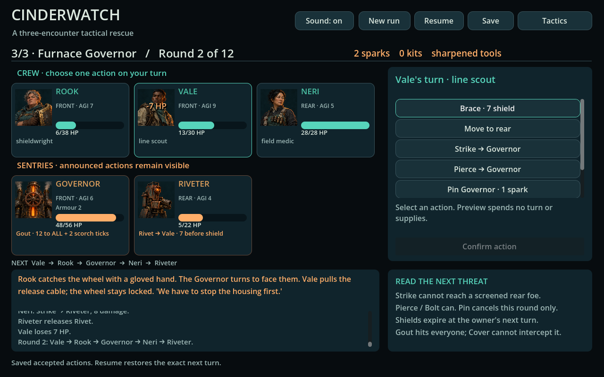

# Cinderwatch — P05 0.2.0

A complete small tactical rescue campaign, newly adapted from P05's turn-based
seed. [Download the compiled native project](dist/cinderwatch-0.2.0.zip) and
[run it with Godot .NET](Native/README.md). This replaces the absence of a P05
runtime with an actual three-encounter destination; it does not restore an RMXP
game or import P10's historical rules.

Rook shields, Vale reaches screened targets or pins an upcoming enemy action,
and Neri treats injuries and scorch with finite kits. Front/rear screening,
fixed announced intentions and stable initiative make timing/target decisions
visible. The yard introduces protection; the gallery's armoured Bulwark and
repair drone reward reaching the rear; the Governor alternates charge and
party-wide steam. Injuries, cells and kits persist. Two salvage decisions trade
recovery against interruption capacity, then cover against damage. The final
scene reacts to which rescuers remain standing.

The interface previews by forking the **same C# domain** that commits actions.
It provides confirmation, manually paced enemy turns, a persistent chronological
log, rules, accepted-action autosave/replay, failure feedback and restart.
No browser bridge, duplicate rules, cloud service or RNG dependency.

## Native identity and action feedback



Eight original generated portraits distinguish the three rescuers and five
machine types. The unchanged 4×2 PNG is consumed through native atlas regions;
these are static portraits, not recovered artwork or animated actor clips.
State dimming, active/selected outlines and fading transaction labels accompany
the actual rules. HP, shielding, row change, Pin and scorch removal feedback is
computed from accepted before/after states rather than an invented damage roll.
Threat/queue/resource text stays visible. No turn is delayed or queued by effects.

Seven original synthesized PCM action cues cover strike, brace, Pin, treatment,
movement, steam and stage completion. Sound can be muted; focus loss, Tactics and
reset stop active playback. A short mixer drain precedes window/test shutdown.
The UI reuses cards/action buttons and a small owned style cache; selection no
longer destroys those controls. Raw media loading makes the compiled project
usable outside source without imported texture/audio caches or an SDK.

[Media provenance](Native/media/provenance.json) and
[execution](../../evidence/cinderwatch/PRESENTATION_RUN.json) distinguish image
production, actual native/mixer checks and Codex visual judgment. A prior CI
Godot/.NET shutdown abort motivated lifetime inspection; bounded clean runs do
not prove every platform/GC schedule is repaired. Physical audio, unassisted
readability, enjoyment/accessibility and commercial clearance remain unverified.
The original 0.1.0 ZIP is retained; rules/save schema 0.1.0 and Core sources remain
unchanged. This increment is native presentation 0.2.0, not an OS executable.

## Build and verify

C#/.NET 10 provides a pure, independently executable domain. Godot .NET 4.6.3
consumes it directly for a native desktop scene. Both tools were available;
Unity was not found. A Unity/editor migration would add setup and integration
cost without improving this bounded turn-based milestone.

```sh
dotnet run --project Checks -c Release
dotnet build Native/Cinder.Native.csproj -c Debug
godot-dotnet --headless --path Native --editor --import --quit
godot-dotnet --headless --path Native -- --verify --save-path /tmp/cinder-source/save.json
python3 tools/check_media.py
python3 tools/pack.py
python3 tools/check_pack.py
```

The pack contains only owned assemblies, configuration and editable sources.
Godot's engine/API assemblies and .NET runtime are external. Rebuilding consumes
the pinned Godot NuGet SDK; playing the compiled pack needs the engine/runtime.

[Execution evidence](../../evidence/cinderwatch/RUN.json) distinguishes compilation,
actual headless controls, OpenGL visual inspection and the delivered consumer
outside source using runtime-only .NET. The implementing-agent controller wins
four salvage routes; a Strike-only controller loses, and Brace-only hits the
deadline. These are bounded comparisons, not an optimal-strategy proof or human
playtest. The initial supply configuration was revised after a route became too
fragile; visible text/layout and incapacitated-character continuity were reviewed.

[Native frame](../../evidence/cinderwatch/governor.png) shows the Governor's real
announced threat, current resources and crew condition. The frame is historical 0.1.0 evidence; the new presentation frame above
records 0.2.0. No old project media was reused. Generated art and native feedback
do not establish finished art direction or independent approval. Timing-free discrete turns do not establish hardware accessibility.
Unassisted play, alternative policies, balance/creative appeal, other platforms,
sound/art production and commercial interest need external evidence.
