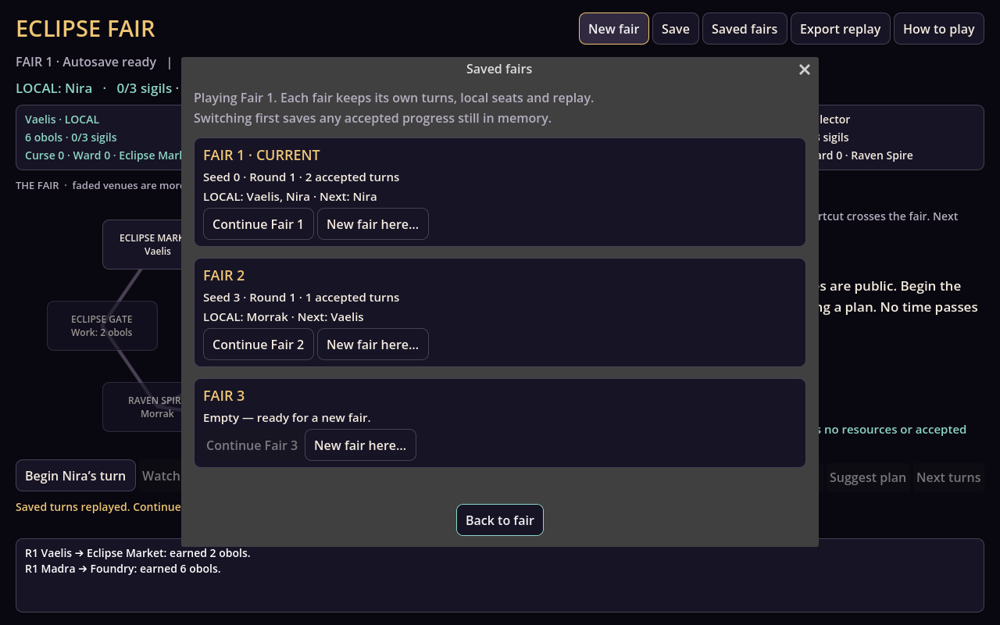
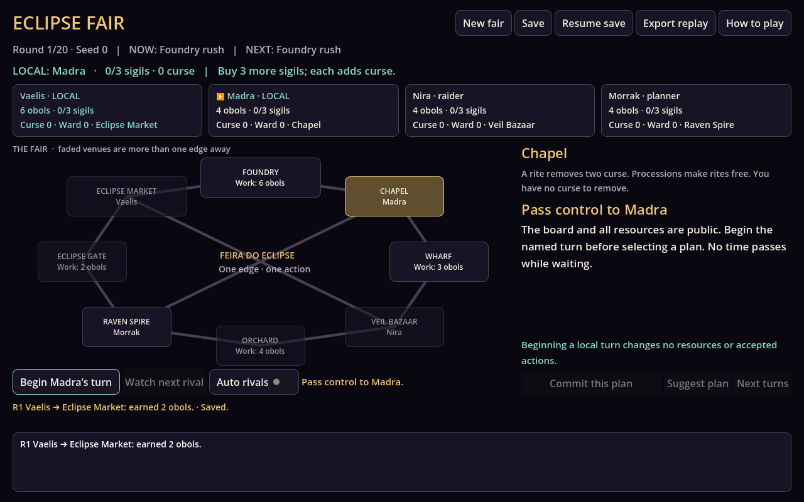

# P01 — Eclipse Fair

**Native 0.6.0** keeps three independent fairs for any-seat solo and two-to-four participant local play in the
[native Godot .NET board](Native/README.md), alongside the
existing **0.1.0** C#/.NET economy workbench and playable terminal match from
Artemyra's Feira do Eclipse seed. One to four local participants share eight
connected venues with optional rivals. Earn obols, buy three sigils, cleanse curse and claim the Gate.
Compare rule variants across common seeds and all four policy/seat rotations.
This is new gameplay, not recovered RPG Maker code. The native consumer uses
the existing Core and journal without duplicating transactions or changing rules.
Native **0.6.0** packages those existing rules as a
[standalone Linux x86_64 player](dist/eclipse-fair-linux-0.6.0.zip), including
Godot .NET and .NET runtime. Extract `EclipseFair/` and run `./eclipse-fair.x86_64`;
[requirements and launch](Native/README.md#play-the-linux-distribution).
The optional [compiled project pack](dist/eclipse-board-0.6.0.zip) still supports
engine users. All earlier releases are preserved.
[Slot execution](../../evidence/eclipse-fair/SLOT_RUN.json) records the baseline,
current source/packages, persistence checks and scripted interface review.
[0.5.0 release execution](../../evidence/eclipse-fair/RELEASE_RUN.json) retains
its original standalone-runtime and compatibility scope.
[Prior local-play execution](../../evidence/eclipse-fair/LOCAL_RUN.json) retains
its original source/runtime-dependent scope.



**Saved fairs** shows three fixed slots with replay-validated seed, round,
accepted turns, local participants and next participant or finished winners.
New fair defaults to an empty slot and saves immediately; replacing an occupied
or invalid slot requires explicit confirmation. Continue restores the selected
history and local controls. Switching preserves pending accepted progress and
blocks on a failed save, so a storage failure cannot silently discard it.
Fair 1 keeps the existing `match.json`; Fair 2/3 use `match.slot2.json` and
`match.slot3.json`, with separate replay exports. Startup opens Fair 1; choose
other slots through Saved fairs. There are no custom names, cloud sync or undo.
[Save and recovery instructions](Native/README.md#keep-and-resume-three-fairs).

New fair selects LOCAL seats. Multi-participant turns require an explicit named
handoff; previews/maps/results follow the actual actor. **Next turns** forecasts
only rivals up to the next local decision. Native saves retain local controls;
old journals resume with Vaelis, and **Export replay** preserves the economy-only
format. No LAN or unknown human action is simulated as a forecast.



Planning mode adds Planner, Warden and Raider. Each compares legal first moves by
projecting a race to the actual Gate/deadline using public classic policy models,
then replans after accepted actions. **Next turns** executes configured rival
profiles in a fork up to the next local decision; compare another legal plan to see
different replies and budgets. New fair also offers **Classic**. Saved classic
profiles stay classic; previous 0.2.0/0.3.0 native packs are retained.

The bounded comparison uses 12 common seeds and four seat rotations, with an
unchanged Collector proxy: win credit falls from 10.5/48 to 2/48 against the new
rivals; actual blocked thefts rise from 0 to 20. Gate finishes are 31 versus 28;
the new race is more contested in this fixture, not universally faster or proven
balanced for people. A separate income-control fixture finishes in 63 versus 69
accepted turns. No independent human play or general optimality is claimed.

## Play the original compiled terminal package

Install the **.NET 10 runtime**, unzip `dist/eclipse-fair-0.1.0.zip`, then:

```bash
dotnet eclipse.dll play --seed 1
dotnet eclipse.dll play --load examples/partial-journal.json
dotnet eclipse.dll demo --seed 1 --out out/demo
dotnet eclipse.dll replay --load out/demo/journal.json
dotnet eclipse.dll compare --variant rules/expensive-seals.json --runs 100 --seed 0 --out out/compare
```

The pack contains compiled DLLs/configuration, rules and an actual accepted-action
example. No SDK, platform host, engine, art or audio binary is redistributed.
The runtime is required; this is not a self-contained executable. Linux x86_64
was executed. Other platforms remain unverified. Python/SDK are unnecessary for
playing the pack; rebuilding/checking source requires SDK **10.0.401** and Python.

In play mode you control Vaelis. Choose a numbered plan; each shows its destination
and actual projected obols/curse/sigils. Other participants take visible turns.
`hint` offers a heuristic suggestion; `auto` accepts it for one assisted turn.
`help` explains tactics. `save path.json` atomically replaces that requested file;
`quit` leaves without automatic saving. Loading rebuilds accepted actions in a
fresh match, including the forecast, rotating initiative and agent policies.
EOF leaves cleanly. No undo, trusted state snapshot or hidden offline progress.

## What decisions change

| System | Consequence |
|---|---|
| Travel | Stay or cross one edge, then take one action. Moving costs one obol; earning on arrival makes routing part of the budget. |
| Work | Venue wages differ; forecast rush/blight/procession/wharf conditions change returns. Curse reduces wages by up to two, with a floor of one. |
| Sigils | Markets 0/4 charge 6, 8, 10; from round 11 each price rises by one. A purchase adds one curse. Buying every available sigil has a recovery cost. |
| Rites | Chapel 2 removes up to two curse for two obols; a procession makes the rite free. Returning there costs route/time. |
| Protection/theft | A two-obol raven ward blocks one co-located theft. Theft transfers up to three existing obols and adds curse when successful. It never mints money. |
| Finish | Claim at Gate 7 with three sigils and zero curse. Otherwise the fair closes after 20 rounds; rank by sigils, least curse, then obols. Exact ties share the result. |

Map: `0—1—2—3—4—5—6—7—0`, with shortcuts `0↔4`, `2↔6`.
Market 0, Foundry 1, Chapel 2, Wharf 3, Bazaar 4, Orchard 5, Spire 6, Gate 7.
Initial positions and initiative shift with the seed; initiative rotates each
round. Current/next forecasts and all positions/resources are public information.

Collector prioritizes purchases, rites and the Gate; Keeper values protection
around rivals; Opportunist considers disrupting a co-located competitor. Worker
is an intentionally income-only control, not a balanced fourth playable class.
These four classic policies retain their original one-turn previews/next wages.
The new planning profiles are available in current source/native mode; old
compiled packages reject their names. Journal schema/rules remain 0.1.0; new
planning names require the new consumer. Projections assume public response
models and do not know a human's future input. They are not optimal solvers.

## Compare an actual scenario

`--runs` means distinct seeds. Each scenario executes four seat rotations for
every seed, so 100 seeds produce 400 matches and 1,600 participant rows per scenario.
`matches.csv` records each participant/result/economy; `summary.json` records rules,
completion, duration and fractional win credits for ties. Baseline and variant
share seeds/rotations. Relative policy order is retained; this is not all 24
permutations, independent agents, human play or a market forecast.

The included price variant changes the first price from six to eight. Actual
100-seed/four-rotation execution produced **258/400** baseline Gate claims versus
**223/400** under the price variant. Income-only Worker earned zero win credit;
Opportunist led the synthetic policies. These are observations of these rules and
agents, not proof of fair human balance. The initial 15-round/weak-route prototype
produced no Gate claims among the tested policies; production-aware planning and
20 rounds produced observed claims while retaining deadline outcomes. This does
not prove the earlier rules unwinnable for people. Further pacing needs people.

Rules validate bounded integer parameters (starting funds 0–30, goal 1–6, rounds
4–40, first price 1–30, price step 0–10, movement 0–5, rites 0–10, work bonus −1–5).
Unknown fields/options, unsupported journals and unavailable actions are rejected.
Seed range is 0–1,000,000; comparison accepts 1–1,000 seeds. This is in-match economy,
not real monetary modeling, financial advice or a live-service monetization model.

## Build and verify source

```bash
dotnet build Checks/Eclipse.Checks.csproj -c Release
dotnet run --project Checks -c Release --no-build
python3 tools/check_cli.py
dotnet publish Cli/Eclipse.Cli.csproj -c Release --no-self-contained -p:DebugType=None -o out/publish
python3 tools/pack.py
```

No NuGet package or test framework is required for Core/CLI; the native consumer
uses the pinned Godot SDK. Core owns transactions/agents;
CLI owns JSON/files/terminal/reporting. Thirteen C# checks cover actual public contracts,
including conservation across 100 classic matches, three planning checks for
actual racing, conditional replies, determinism/replay and bounded rules. The Python workflow drives
the compiled process through input rejection, hint/save/resume, full assisted play,
replay and comparison/CSV. CI compiles source and executes the shipped package.

[Execution](../../evidence/eclipse-fair/RUN.json) distinguishes compilation,
terminal input, package consumption, synthetic comparisons and implementing-agent
design review. [Provenance](provenance.json) records the seed adaptation. The original evidence is for the terminal 0.1.0 workbench; native 0.2.0 execution
is recorded separately, with 0.3.0 planning in PLANNING_RUN.json. No historical runtime restoration, other-OS standalone export,
physical controller, human enjoyment, commercial adoption or exclusive rights is
claimed. This net10.0 domain is not a drop-in Unity DLL.

Next observe unassisted native decisions, forecast understanding and rival pacing
before choosing new minigames, maps or economy changes. Avoid expanding the old
48-tile roster/LAN plan before the smaller economy earns that scope.
