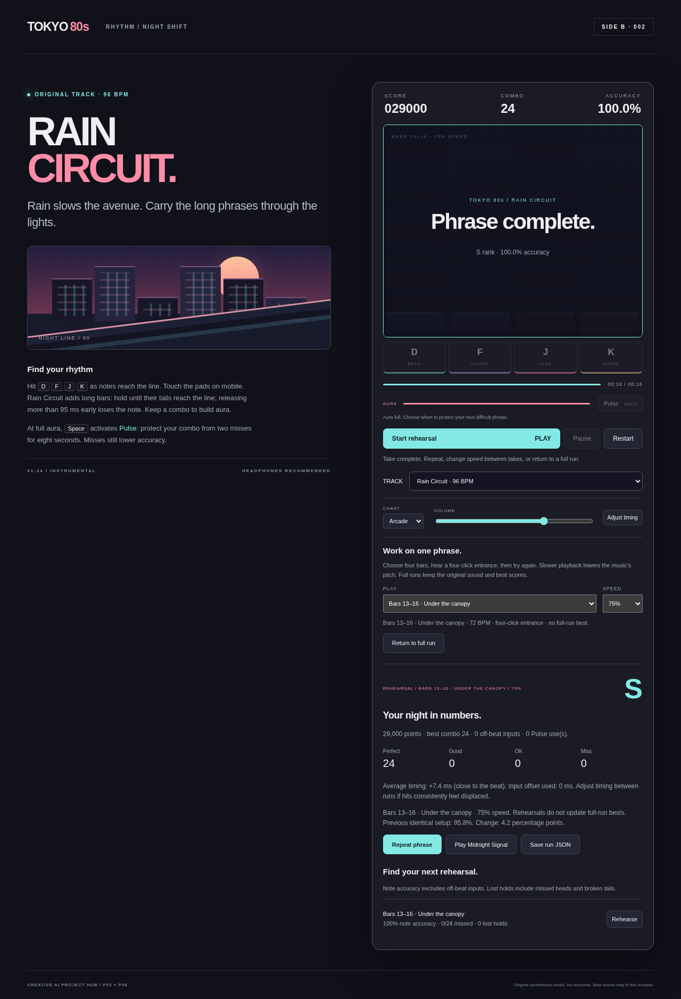
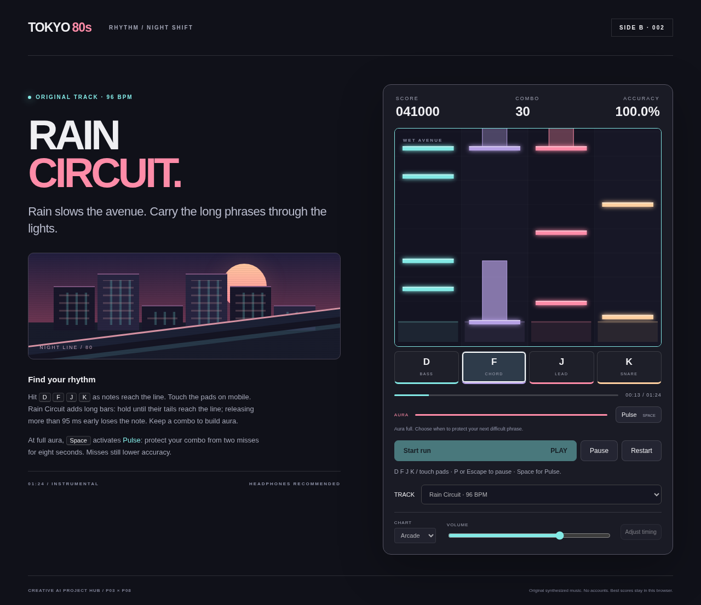

# P03 — Tokyo 80s: Night Shift

Version **0.4.0**. Two complete original stages with a selectable setlist.
Midnight Signal preserves its original audio/charts and best-score keys; Rain
Circuit introduces musical sustain interaction. The original 0.1.0 stage is an
original 69-second
instrumental, four lanes, two score-aligned charts, judgments, combo/aura, personal
timing calibration, pause, results, local best and replay. P08 supplies the real
rendered soundtrack, not a planned cue or external recording. This is a new
implementation from the Tokyo 80s seed; the historical ZIP was not recovered.

## Musical rehearsal



Choose a four-bar phrase in **PLAY**, choose **75%, 90% or 100% SPEED**, then
**Start rehearsal**. Both songs/charts have eight phrases. One bar of the actual
preceding soundtrack and four scheduled clicks lead into the selected notes.
75% and 90% backing now keeps the original pitch: four offline Vorbis derivatives
come from the unchanged stereo PCM masters using FFmpeg/Rubber Band. The browser
plays each prepared buffer at 1× and uses its stretched offset/duration. 100% and
full runs use the unchanged original OGG. Only one decoded backing is cached;
build tools are unnecessary to play. The stage identifies bars/speed/pitch. Each take stops for review rather than starting an unattended loop.

Performance-time conversion keeps the ±45/95/145 ms judgments, personal offset,
release grace and pause/re-hold behavior in real seconds. Note heads belong to
one phrase; sustained tails crossing its boundary finish without truncation.
Keyboard/touch, pause, restart and **Return to full run** work within rehearsal.
Aborting stops source/click nodes and requires an explicit start for more sound.
Leaving the tab/window during loading cancels startup; returning requires Start.
Late downloads cannot replace a subsequently selected track. Missing or wrong-
duration derivatives show an error before any backing/click plays; no detuned fallback.

Full-run results show actual note accuracy, missed notes and lost holds for each
phrase, with **Rehearse** shortcuts. Phrase note accuracy excludes off-beat inputs;
whole-run accuracy still includes them. Lost holds include missed heads and
broken tails. Repeating the same song/chart/phrase/speed/offset compares the last
two completed takes in memory. It is a local observation, not evidence of a
person's learning. Different setups are not compared.

Rehearsals never write full-track bests. Returning to a full run restores original
tempo/charts and the existing best keys. **Save run JSON** identifies mode/rate,
phrase bounds, source audio offset and note source times/durations alongside
performance seconds. The retained `playbackRate` field means performance tempo;
the additive `backing` identifies the actual URL, unit node rate and stretched
buffer offset/duration. Full-run exports retain their previous note times/durations
at rate 1, with additive mode and phrase summaries. No run importer is added.
[Execution](../../evidence/tokyo80s/REHEARSAL_RUN.json) separates real playback,
synthetic input, original-version comparison and implementing-agent visual review.

[Pitch execution](../../evidence/tokyo80s/PITCH_RUN.json) records actual old/current
Web Audio playback, decoded artifacts, encoded tone/transient probes and sampled
musical envelopes. Actual OfflineAudioContext output of Midnight Signal's ending
shows the prior lowered harmonies and current original-pitch backing. These are
bounded signal/integration checks, not physical listening or improved learning.

Rebuild only the derivatives with `python3 tools/render_rehearsal.py` from this
project. FFmpeg must include Rubber Band and libvorbis. The producer verifies
original master hashes, measures float peaks, leaves encoding headroom, checks
duration drift and publishes four complete assets plus their provenance/catalogue.
It never regenerates the original masters/scores. Encoder stream identities can
differ between runs/tool versions; byte-identical rebuilding is not promised.

## Rain Circuit



[Listen/download the Vorbis track](dist/assets/rain-circuit.ogg) · [PCM master](media/rain-circuit.wav).

A new 84.5-second stage at **96 BPM**, with swung hats, FM-like keys, rounded bass,
an eight-bar lead call/answer, a stripped canopy bridge and higher-key finale.
The actual stereo WAV master, Vorbis game asset, score and producer are included;
no samples/MIDI/quoted melody or historical audio recovery. [Production](media/rain-provenance.json)
separates technical measurements from musical judgment.

Select **TRACK** before playing. Practice has 106 notes/28 holds; Arcade has
286 notes/45 holds. Long bars require a timed head and carried tail; releasing
more than 95 ms early misses the entire note. A successful tail earns its head
judgment once, with no bonus for repeated/aliased input. Score/aura are earned
only at completion. Other lanes remain playable while sustaining.

Pause freezes audio and holds. Re-hold lit lanes before Resume, or within 200 ms
after resuming; otherwise the hold fails. This avoids automatically completing
an abandoned hold. Window/tab interruption uses the same explicit resume policy.
Pulse can protect combo on a failed hold; accuracy still counts the miss. Miss
and tail events resolve in chronological song order even after delayed frames.

Results identify the actual track/difficulty and hold durations in exported JSON.
**Play the other stage** starts that selected song with reset state and its own
buffer/clock. Bests are separate per song/chart; old Midnight Signal bests and
personal timing offset stay compatible. Both stages are available immediately.
[Execution](../../evidence/tokyo80s/SETLIST_RUN.json) records real clock workflows,
keyboard/touch, carried/broken/paused holds, exports and source-score contracts.
Synthetic play and Codex score/visual review are not human listening/playtests.

## Play locally

From the lab directory, with Node 22+:

```bash
node projects/tokyo80s/server.mjs
```

Open `http://127.0.0.1:4173`. The game is buildless static HTML/JS; any ordinary
static server can serve `dist/`. No npm installation, account, model API or
remote service is needed for gameplay. Opening `index.html` directly as a file
is unsupported because the browser fetches the score and audio.

For Midnight Signal, click **Start run**, listen to the count-in, and press **D F J K** or the arrow
keys at the hit line. Touch the four pads on mobile. Practice has 112 notes;
Arcade has 236, with lead syncopation, chord hits and a busier finale. Each lane
matches attacks of its named instrument in the rendered score. The underpass
section gives both the music and chart a quieter phrase.

Perfect/Good/OK windows are ±45/95/145 ms. Late notes become misses; off-beat
presses break combo and deduct points/aura, so key spam cannot farm score.
Holding a key does not hit repeatedly. Combo raises the score multiplier to four.
At full aura, **Space** or **Pulse** protects combo from two misses for eight
seconds; it does not hit notes or award points, and misses still lower accuracy.
Protection uses the note deadline, so a delayed rendering frame cannot change it.

**Pause**, **P** or **Escape** freezes the actual audio clock. Leaving the tab
pauses; returning never automatically resumes. **Restart** clears the session.
Results include all judgments, score, best combo, timing bias and Pulse use.
**Save run JSON** exports actual scored notes. Best scores and input offset stay
in this browser when storage is available; gameplay/export still work without it.

**Adjust timing** plays twelve real scheduled clicks. Tap with F/the pad; the
first two are warm-up. At least six later taps yield a median offset. Positive
values compensate late input, negative values early input; the range is ±150 ms.
Apply between runs. This is a personal calibration, not a measured device latency.
Closing the dialog cancels remaining sound nodes. Volume stays adjustable in play.

A private Sites identity is retained in [.openai/hosting.json](.openai/hosting.json).
This 0.4.0 execution updates GitHub only; the retained Site was not redeployed.
Its deployment status is reported separately; an ID is not publication
proof. GitHub remains the maintained source. The Site publishes only `dist/`
and its hosting manifest, with owner-only access and no accounts/connector data.

## Audio and origin

[Production provenance](media/provenance.json) identifies the actual WAV master,
OGG runtime asset, score/chart hashes and deterministic synthesis seed. The
[producer](tools/render_track.py) contains the new eight-bar call/response,
four-chord progression, bass, pad, lead and percussion synthesis. No third-party
samples, MIDI import, licensed song or historical audio master was used. This
is Codex-authored algorithmic music under Martin's direction, not human composition
or exclusive copyright validation. The visual city is original CSS, not imported art.

The track has a three-second count-in, 32 four-beat bars at 120 BPM and a two-second
ending: **69 seconds**, stereo PCM16 at 44.1 kHz. OGG is the browser export.
Measured decoded OGG loudness is -14.3 LUFS with -0.7 dBFS true peak; the PCM
master has no clipped samples. These technical measurements do not prove musical
taste or hardware sound quality. No independent listening session has occurred.

To regenerate, install NumPy and ffmpeg with libvorbis, then run:

```bash
python3 projects/tokyo80s/tools/render_track.py
```

The PCM master uses a fixed synthesis seed. Encoded OGG stream metadata can vary
between encoder runs/versions; rerun checks and update provenance after production.
Do not regenerate assets as part of normal gameplay or QA.

## Verify

Timing/scoring and audio contracts need Node/Python, without game dependencies:

```bash
node --test projects/tokyo80s/tests/core.test.mjs projects/tokyo80s/tests/holds.test.mjs projects/tokyo80s/tests/rehearsal.test.mjs
python3 projects/tokyo80s/tools/check_audio.py
python3 projects/tokyo80s/tools/check_rehearsal_audio.py
# With FFmpeg/Rubber Band, also decode assets and run encoded signal probes:
python3 projects/tokyo80s/tools/check_rehearsal_audio.py --signal
```

Browser checks reuse the already-pinned Playwright QA dependency from P11; this
is a test dependency, not a shared gameplay module or P11 runtime change:

```bash
npm ci --prefix projects/realtime-integration-lab
CHROMIUM_PATH=/usr/bin/chromium node --test projects/tokyo80s/tests/browser.test.mjs projects/tokyo80s/tests/setlist.test.mjs projects/tokyo80s/tests/rehearsal-browser.test.mjs
```

Choose an installed matching Chromium path. The browser suite executes the real
AudioContext/decoded OGG, keyboard and touch, native tab-focus pause, calibration,
retry, mobile/desktop layouts, a complete 69-second Arcade run, JSON export and
replay. Synthetic inputs establish integration, not human rhythmic skill.
[Milestone evidence](../../evidence/tokyo80s/RUN.json) records current execution,
actual outcomes and boundaries. Existing CI includes these checks.

## Quality boundaries and next milestone

This is a playable prototype, not a released commercial rhythm game. Human
play on real keyboard/touch/audio hardware, speaker/headphone latency, enjoyment,
accessibility, Safari/Firefox and musical quality remain unverified. There is
no career progression, licensed catalogue, global leaderboard or
competitive anti-cheat. The caller controls local score data.

Rain Circuit rebuilding uses `python3 projects/tokyo80s/tools/render_rain.py`; the original producer
remains unchanged. Decoded Vorbis measures -14.3 LUFS and -2.9 dBFS true peak.
The new stage's PCM master has no clipped samples and approaches silence at its
ending. These are executed signal measurements, not listening approval.
Next compare original/slow backing on physical output, attack feel and unassisted
phrase practice alongside both arrangements; time stretching can change timbre. Independent musical
quality, learning benefit, other browsers and commercial interest remain open.
