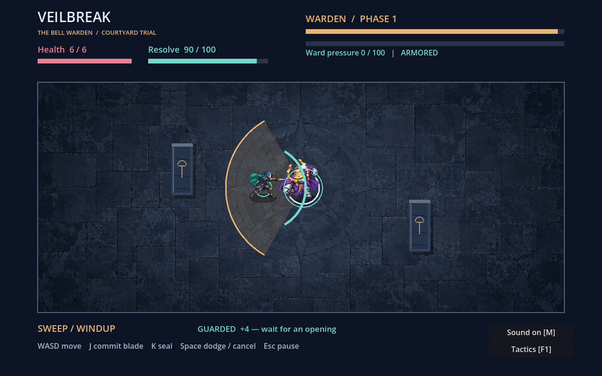

# P06 — Veilbreak: The Bell Warden

Version **0.3.0**, a complete native Godot 2D boss encounter. Move, strike,
cast seals, dodge locked warnings, exploit an open core and survive two phases.
The trial has title/controls, victory/defeat, actual results, pause and restart.
Painted characters/courtyard, distinct attack sounds and phase-responsive music
give the Bell Warden a visual and sonic identity. Two new animation atlases
connect walking, blade preparation/contact/recovery, seal casting, dodge and
Warden attacks to real combat clocks. Committed attacks can miss or be cancelled.
This is a new destination for the Véu Partido seed, not a reconstruction of its
unavailable Unity starter or execution of historical RPG combat formulas.



[Watch the engine-rendered action demonstration](../../evidence/veil-arena/motion-preview.mp4)
(7.2s, 1280x800/30fps, Godot Movie Maker). Positions/stages are declared fixtures
and input is scripted; this is a pose/timing demonstration, not human gameplay
or a real-time hardware performance measurement. Download if GitHub cannot play it inline.

## Play

Install **Godot 4.6.3 standard**. No .NET, addon, browser, package manager or
third-party asset is required. From this directory:

```bash
godot --path .
# Or launch the delivered compiled resource pack without importing the editor project:
godot --main-pack dist/veilbreak.pck
```

The PCK is an actual built game resource package, **not a standalone executable**.
It requires the matching Godot runtime. Linux x86_64/OpenGL was executed; other
platforms and standalone binary exports are unverified. The standard editor can
also open `project.godot` and run `arena.tscn`. Source import and scene execution
were verified; no claim is made that a human opened the graphical editor.

| Input | Action |
|---|---|
| WASD / arrows | Move; native physics bodies collide with walls, columns and the Warden |
| J | Blade, 12 resolve, 0.4s cooldown; aim locks at preparation, contact after 100ms; 4 guarded / 24 open-core damage |
| K | Seal, 34 resolve, 1.1s cooldown; gather for 75ms, then release; 8 damage and 36 ward pressure on impact |
| Space | Directional dodge, 25 resolve, 0.65s cooldown; cancels a pending action; first 0.16s invulnerable, 0.20s movement |
| Enter | Begin, resume or restart after a result |
| Esc | Pause/resume; focus loss also requests pause |
| F1 / Tactics button | Keyboard or native mouse help; freezes the encounter until explicit resume |
| M / Sound button | Mute or restore music and cues; the choice survives encounter restart |

Resolve regenerates at 25/s. Seals travel through the arena and collide with
stone; three sufficiently close impacts break the ward for 2.4s. Pressure decays
after two seconds without another impact. Blade counters use recovery and ward
breaks. Holding J/K/Space does not repeat input; press for each action.

Blade contact checks range (103px) and a 120-degree sector around the locked aim,
at the actual impact time. Moving behind or away from the prepared blade can make
it miss. Blade/cast reduce movement to 65% while committed; their actions last
320/300ms. One action starts at a time; simultaneous J/K favors the legal blade.
Dodge can cancel preparation/recovery, and damage interrupts an unfinished action.
Spent resolve/cooldown stay spent; cancelled contact never lands later. Guard/open
damage is evaluated at contact, so starting just before a recovery closes is risky.

The Warden cycles **sweep**, **charge** and expanding **wave**, locking its aim
during the amber windup. Columns stop a charge and block seals. Wave timing
requires distance or a dodge through its front. At half health the veil fractures:
the transition repels attacks, phase two is faster and begins with a charge whose
landing leaves a separately warned violet echo. An open core is teal; an echo
can make an apparent counter unsafe. No random hit/crit roll conceals the outcome.

Six health units and one continuous 160-health boss fight keep the trial bounded.
Restart clears positions, projectiles, phases, hazards, cooldowns, pressure and
results. Progress is session-only. Controller/touch, campaign and saves are
not implemented. Pause/result screens freeze pose clocks alongside gameplay;
restart clears action, walk, facing and contact state.

## Art and sound

P07 supplies three actual PNG paintings: the bronze/stone Bell Warden, a masked
teal courier and subdued slate paving. Native columns retain their real collision
footprints. Amber warnings, violet echoes, teal open-core rings and the OPEN label
remain explicit game information. Breathing space around the floor prevents the
illustrated bodies from being cropped by the HUD at the physics walls.

P07 also supplies two actual RGBA atlases: 16 poses per character. Courier rows
contain four walk, blade, dodge and seal keyframes; Warden rows contain four heavy
walk, sweep, charge and wave keyframes. Windup holds the anticipatory pose; real
active/recovery stages choose the strike, drive/brake or spent pose. Movement
clocks follow actual body displacement, so a blocked actor does not keep walking.
Frames mirror horizontally to face the action; this is not an eight-direction set.

Initial crowded generations were rejected, then edited for transparent gutters.
Accepted PNG bytes are unchanged. Native [catalog production](tools/build_motion_catalog.gd)
reads alpha bounds, aligns low foot/contact pixels and derives scale/regions; the
game consumes [the catalog](media/motion-catalog.json) without a second animation
clock. Atlas/pose review is Codex judgment, not independent artist/player approval.
These four-keyframe clips retain some generated pose/proportion variation; no
hand-animated interpolation or production-complete character set is claimed.

P08 supplies fourteen actual sound cues and two aligned 24-second music loops.
Sweep, charge and wave have different bell motifs. Guarded hits, counters, seal
casts, ward breaks, damage, dodge, fracture, echo and results sound at their real
state transitions. Voices pan with their arena positions. The second music layer
crossfades over 1.1s after fracture while both transports remain aligned. Pause
freezes music and active cues; explicit resume continues them. Restart clears
voices and returns the music to its quiet beginning. A -1.5dB native hard limiter
bounds overlapping voices. Visual warnings still provide all combat information.

[Media provenance](media/provenance.json) records the generation/edit history,
actual file hashes, original score and synthesis. The first Warden's cropped prongs
were corrected with image_gen; accepted PNGs are copied unchanged. No external
artwork, samples, songs or historical masters were imported. Two PCM masters and
the [producer](tools/render_audio.py) support audio reuse; normal play uses Vorbis
loops and short WAV cues. To regenerate audio, install NumPy and ffmpeg/libvorbis,
then run `python3 tools/render_audio.py`. Encoding metadata may change; reimport
and update hashes/package after production. Normal tests never regenerate media.

## Build and verify

```bash
godot --headless --path . --editor --import --quit
godot --headless --path . --script tests/encounter.gd --fixed-fps 60
python3 tools/check_media.py
godot --headless --path . --script tests/presentation.gd
godot --headless --path . --script tests/motion.gd
godot --headless --path . --export-pack Linux dist/veilbreak.pck
# Only after accepting new source PNGs; does not modify their pixels:
godot --headless --path . --script tools/build_motion_catalog.gd
```

The export preset excludes tests/tools/documentation/distribution and PCM music
masters. Runtime textures and sound assets are included. PCK export does not
need platform templates. A standalone Linux executable needs Godot's matching
export templates, which were not installed or used here. Do not call the PCK an
OS executable. CI downloads the pinned official engine ZIP, verifies its published
SHA-256, runs source gameplay, executes the shipped pack and builds/tests a fresh
pack. The same media/lifecycle checks execute outside the source directory against
the delivered and rebuilt PCK. Cache folders are ignored; import/UID metadata is retained.

Twenty-four scene/PhysicsServer checks exercise actual movement/columns, guarded/open
damage, resolve, real projectile impacts, ward break, transition, idle defeat,
native Viewport GUI input, focus-notification handling, pause/restart and complete
scripted victory, delayed contact and held-key behavior. Fixed-fps automation is synthetic input, not hardware timing
or human playtesting. Historical 0.1.0 experiments recorded a passive ranged loss;
the current reactive counter/seal controller completes 0.3.0 in 55.58 simulated seconds,
1 health/26 hits/one phase change; the executed 0.2.0 pack completes in 51.87s,
2 health/26 hits. This bounded comparison shows increased commitment risk,
not human balance or difficulty suitability. One comparison does
not establish absence of dominant strategies.

Twenty-four additional native checks decode actual music resources, exercise
legal-input cues, mouse/keyboard mute, pause/resume and restart, measure actual
AudioServer samples with music and an isolated cue, preserve stem alignment and
stress the limiter with eight voices/+12dB gain. Dummy audio produces a measured
mix without a physical output device. This is technical audio verification,
not a listening review. OpenGL captures support Codex's visual assessment of
title, warnings, open core, echo, tactics, results and top/bottom wall framing.

Thirty-six motion checks cover actual imported alpha borders/content, opaque pose
bounds at wall limits, delayed once-only contacts, locked orientation/whiffs,
dodge/hurt cancellation, action priority, pause/resume/restart and walk frames.
Source, delivered PCK and fresh rebuilt PCK execute outside-source workflows.

[Current execution](../../evidence/veil-arena/MOTION_RUN.json) records production,
combat comparison, actual OpenGL frames/movie and source/pack checks.
[Prior presentation execution](../../evidence/veil-arena/PRESENTATION_RUN.json) separates
0.2.0 media production, import, mix and rendering.
[Initial encounter execution](../../evidence/veil-arena/RUN.json) remains historical.
Windows,
macOS, physical input, accessibility, natural OS focus behavior, enjoyment and
commercial demand remain unverified. Generated paintings/synthesized audio are
integrated prototypes; exclusive copyright and commercial clearance are unverified.
Godot is MIT-licensed; engine use
does not establish exclusive rights or commercial clearance for the whole portfolio.

Next: unassisted keyboard and headphone/speaker trials, then improve pacing and opponent
variation where observations support it. A Unity/C# or 3D destination remains a
separate decision, requiring its real starter/tools and a product reason.
