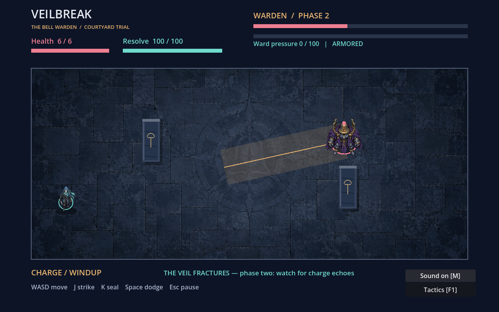

# P06 — Veilbreak: The Bell Warden

Version **0.2.0**, a complete native Godot 2D boss encounter. Move, strike,
cast seals, dodge locked warnings, exploit an open core and survive two phases.
The trial has title/controls, victory/defeat, actual results, pause and restart.
Painted characters/courtyard, distinct attack sounds and phase-responsive music
now give the Bell Warden an integrated visual and sonic identity.
This is a new destination for the Véu Partido seed, not a reconstruction of its
unavailable Unity starter or execution of historical RPG combat formulas.



## Play

Install **Godot 4.6.3 standard**. No .NET, addon, browser, package manager or
third-party asset is required. From this directory:

```bash
godot --path .
# Or launch the delivered compiled resource pack without importing the editor project:
godot --main-pack dist/veilbreak.pck
```

The PCK is an actual built game resource package, **not a standalone executable**.
It requires the matching Godot runtime. Linux x86_64/OpenGL was executed; other
platforms and standalone binary exports are unverified. The standard editor can
also open `project.godot` and run `arena.tscn`. Source import and scene execution
were verified; no claim is made that a human opened the graphical editor.

| Input | Action |
|---|---|
| WASD / arrows | Move; native physics bodies collide with walls, columns and the Warden |
| J | Strike, 12 resolve, 0.4s cooldown, short reach; 4 guarded / 24 open-core damage |
| K | Seal projectile, 34 resolve, 1.1s cooldown; 8 damage and 36 ward pressure on impact |
| Space | Directional dodge, 25 resolve, 0.65s cooldown; first 0.16s invulnerable, 0.20s movement |
| Enter | Begin, resume or restart after a result |
| Esc | Pause/resume; focus loss also requests pause |
| F1 / Tactics button | Keyboard or native mouse help; freezes the encounter until explicit resume |
| M / Sound button | Mute or restore music and cues; the choice survives encounter restart |

Resolve regenerates at 25/s. Seals travel through the arena and collide with
stone; three sufficiently close impacts break the ward for 2.4s. Pressure decays
after two seconds without another impact. Blade counters use recovery and ward
breaks. Holding J/K/Space does not repeat input; press for each action.

The Warden cycles **sweep**, **charge** and expanding **wave**, locking its aim
during the amber windup. Columns stop a charge and block seals. Wave timing
requires distance or a dodge through its front. At half health the veil fractures:
the transition repels attacks, phase two is faster and begins with a charge whose
landing leaves a separately warned violet echo. An open core is teal; an echo
can make an apparent counter unsafe. No random hit/crit roll conceals the outcome.

Six health units and one continuous 160-health boss fight keep the trial bounded.
Restart clears positions, projectiles, phases, hazards, cooldowns, pressure and
results. Progress is session-only. Controller/touch, campaign and saves are
not implemented. The two static painted character poses use native bob/flash;
full movement/attack animation remains a separate production opportunity.

## Art and sound

P07 supplies three actual PNG paintings: the bronze/stone Bell Warden, a masked
teal courier and subdued slate paving. Native columns retain their real collision
footprints. Amber warnings, violet echoes, teal open-core rings and the OPEN label
remain explicit game information. Breathing space around the floor prevents the
illustrated bodies from being cropped by the HUD at the physics walls.

P08 supplies fourteen actual sound cues and two aligned 24-second music loops.
Sweep, charge and wave have different bell motifs. Guarded hits, counters, seal
casts, ward breaks, damage, dodge, fracture, echo and results sound at their real
state transitions. Voices pan with their arena positions. The second music layer
crossfades over 1.1s after fracture while both transports remain aligned. Pause
freezes music and active cues; explicit resume continues them. Restart clears
voices and returns the music to its quiet beginning. A -1.5dB native hard limiter
bounds overlapping voices. Visual warnings still provide all combat information.

[Media provenance](media/provenance.json) records the generation/edit history,
actual file hashes, original score and synthesis. The first Warden's cropped prongs
were corrected with image_gen; accepted PNGs are copied unchanged. No external
artwork, samples, songs or historical masters were imported. Two PCM masters and
the [producer](tools/render_audio.py) support audio reuse; normal play uses Vorbis
loops and short WAV cues. To regenerate audio, install NumPy and ffmpeg/libvorbis,
then run `python3 tools/render_audio.py`. Encoding metadata may change; reimport
and update hashes/package after production. Normal tests never regenerate media.

## Build and verify

```bash
godot --headless --path . --editor --import --quit
godot --headless --path . --script tests/encounter.gd --fixed-fps 60
python3 tools/check_media.py
godot --headless --path . --script tests/presentation.gd
godot --headless --path . --export-pack Linux dist/veilbreak.pck
```

The export preset excludes tests/tools/documentation/distribution and PCM music
masters. Runtime textures and sound assets are included. PCK export does not
need platform templates. A standalone Linux executable needs Godot's matching
export templates, which were not installed or used here. Do not call the PCK an
OS executable. CI downloads the pinned official engine ZIP, verifies its published
SHA-256, runs source gameplay, executes the shipped pack and builds/tests a fresh
pack. The same media/lifecycle checks execute outside the source directory against
the delivered and rebuilt PCK. Cache folders are ignored; import/UID metadata is retained.

Twenty-two retained scene/PhysicsServer checks exercise actual movement/columns, guarded/open
damage, resolve, real projectile impacts, ward break, transition, idle defeat,
native Viewport GUI input, focus-notification handling, pause/restart and complete
scripted victory. An OpenGL/Xorg dummy-display run adds eight framebuffer checks
and screenshots. Fixed-fps automation is synthetic input, not hardware timing
or human playtesting. A passive ranged circuit lost; a reactive counter/seal
controller won. The same scripted victory remains 51.87 simulated seconds, 2 health,
26 hits and one phase change after this media integration. One comparison does
not establish absence of dominant strategies.

Twenty-four additional native checks decode actual music resources, exercise
legal-input cues, mouse/keyboard mute, pause/resume and restart, measure actual
AudioServer samples with music and an isolated cue, preserve stem alignment and
stress the limiter with eight voices/+12dB gain. Dummy audio produces a measured
mix without a physical output device. This is technical audio verification,
not a listening review. OpenGL captures support Codex's visual assessment of
title, warnings, open core, echo, tactics, results and top/bottom wall framing.

[Current execution](../../evidence/veil-arena/PRESENTATION_RUN.json) separates
media production, import, actual mix, native rendering and pack execution.
[Initial encounter execution](../../evidence/veil-arena/RUN.json) remains historical.
Windows,
macOS, physical input, accessibility, natural OS focus behavior, enjoyment and
commercial demand remain unverified. Generated paintings/synthesized audio are
integrated prototypes; exclusive copyright and commercial clearance are unverified.
Godot is MIT-licensed; engine use
does not establish exclusive rights or commercial clearance for the whole portfolio.

Next: unassisted keyboard and headphone/speaker trials, then improve pacing and opponent
variation where observations support it. A Unity/C# or 3D destination remains a
separate decision, requiring its real starter/tools and a product reason.
