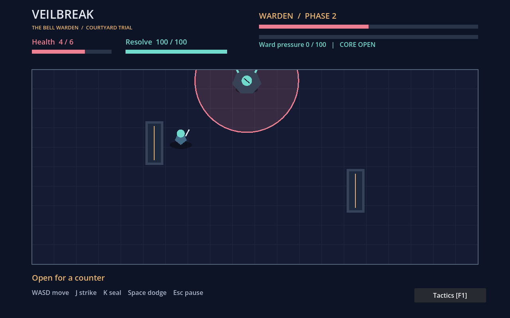

# P06 — Veilbreak: The Bell Warden

Version **0.1.0**, a complete native Godot 2D boss encounter. Move, strike,
cast seals, dodge locked warnings, exploit an open core and survive two phases.
The trial has title/controls, victory/defeat, actual results, pause and restart.
This is a new destination for the Véu Partido seed, not a reconstruction of its
unavailable Unity starter or execution of historical RPG combat formulas.



## Play

Install **Godot 4.6.3 standard**. No .NET, addon, browser, package manager or
third-party asset is required. From this directory:

```bash
godot --path .
# Or launch the delivered compiled resource pack without importing the editor project:
godot --main-pack dist/veilbreak.pck
```

The PCK is an actual built game resource package, **not a standalone executable**.
It requires the matching Godot runtime. Linux x86_64/OpenGL was executed; other
platforms and standalone binary exports are unverified. The standard editor can
also open `project.godot` and run `arena.tscn`. Source import and scene execution
were verified; no claim is made that a human opened the graphical editor.

| Input | Action |
|---|---|
| WASD / arrows | Move; native physics bodies collide with walls, columns and the Warden |
| J | Strike, 12 resolve, 0.4s cooldown, short reach; 4 guarded / 24 open-core damage |
| K | Seal projectile, 34 resolve, 1.1s cooldown; 8 damage and 36 ward pressure on impact |
| Space | Directional dodge, 25 resolve, 0.65s cooldown; first 0.16s invulnerable, 0.20s movement |
| Enter | Begin, resume or restart after a result |
| Esc | Pause/resume; focus loss also requests pause |
| F1 / Tactics button | Keyboard or native mouse help; freezes the encounter until explicit resume |

Resolve regenerates at 25/s. Seals travel through the arena and collide with
stone; three sufficiently close impacts break the ward for 2.4s. Pressure decays
after two seconds without another impact. Blade counters use recovery and ward
breaks. Holding J/K/Space does not repeat input; press for each action.

The Warden cycles **sweep**, **charge** and expanding **wave**, locking its aim
during the amber windup. Columns stop a charge and block seals. Wave timing
requires distance or a dodge through its front. At half health the veil fractures:
the transition repels attacks, phase two is faster and begins with a charge whose
landing leaves a separately warned violet echo. An open core is teal; an echo
can make an apparent counter unsafe. No random hit/crit roll conceals the outcome.

Six health units and one continuous 160-health boss fight keep the trial bounded.
Restart clears positions, projectiles, phases, hazards, cooldowns, pressure and
results. Progress is session-only. There is no audio, controller/touch support,
campaign, save system or finished production art in this prototype.

## Build and verify

```bash
godot --headless --path . --editor --import --quit
godot --headless --path . --script tests/encounter.gd --fixed-fps 60
godot --headless --path . --export-pack Linux dist/veilbreak.pck
```

The export preset excludes tests/documentation/distribution. PCK export does not
need platform templates. A standalone Linux executable needs Godot's matching
export templates, which were not installed or used here. Do not call the PCK an
OS executable. CI downloads the pinned official engine ZIP, verifies its published
SHA-256, runs source gameplay, executes the shipped pack and builds/tests a fresh
pack. Cache folders are ignored; `.gd.uid` metadata is retained.

Twenty-two scene/PhysicsServer checks exercise actual movement/columns, guarded/open
damage, resolve, real projectile impacts, ward break, transition, idle defeat,
native Viewport GUI input, focus-notification handling, pause/restart and complete
scripted victory. An OpenGL/Xorg dummy-display run adds eight framebuffer checks
and screenshots. Fixed-fps automation is synthetic input, not hardware timing
or human playtesting. A passive ranged circuit lost; a reactive counter/seal
controller won. One comparison does not establish absence of dominant strategies.

[Execution](../../evidence/veil-arena/RUN.json) separates engine import, gameplay,
native rendering, package build/execution and implementing-agent review. Windows,
macOS, physical input, accessibility, natural OS focus behavior, enjoyment and
commercial demand remain unverified. The artwork is original runtime geometry,
not recovered sprites or generated paintings. Godot is MIT-licensed; engine use
does not establish exclusive rights or commercial clearance for the whole portfolio.

Next: unassisted keyboard trials, then improve encounter pacing and opponent
variation where observations support it. A Unity/C# or 3D destination remains a
separate decision, requiring its real starter/tools and a product reason.
