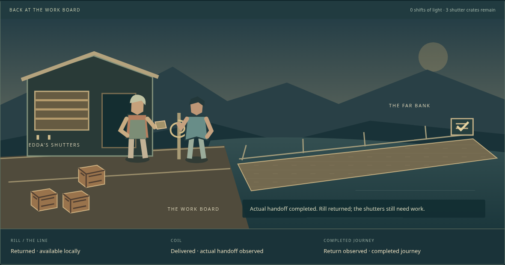
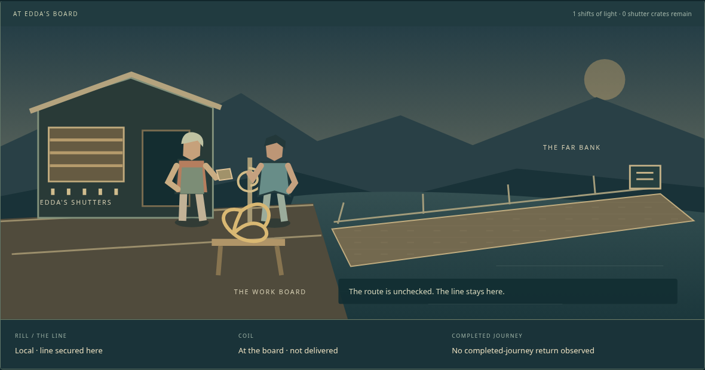

# The coil and the shutters — a recipient case study

A small original scene asks you to divide a remaining day between unfinished local
work and a far-bank handoff. Edda has five shutter crates to secure. Rill keeps the
line secured until the route is surveyed and his current offer is heard. Signing
reserves his help; it does not depart, deliver the coil or establish his return.

This case study presents the **existing downloadable C# scene**. Its continuous
walkthrough is actual Linux/Chromium execution of the extracted private-runtime
recipient, not a new game, Unity player, Windows run or participant session.

[](../evidence/portfolio/walkthrough.webm)

[Watch the continuous walkthrough —43.12s](../evidence/portfolio/walkthrough.webm) ·
[Actual producer/actions/results](../evidence/portfolio/RUN.json) ·
[Artifact map](portfolio.json) · [Public overview](../../../README.md)

## What the choices cost

The route is an actual nested Crossing encounter. Survey entry spends one shift;
finishing its threats establishes a surveyed route, not a completed handoff. Hearing
Rill, writing terms and explicitly confirming retain separate consent boundaries.
A signature reserves him locally for preparation and reduces local work capacity;
it does not put him across the river.

Guided departure spends two shifts. Solo departure spends three and leaves Rill
local. Actual accepted encounter actions still have to finish the chosen crossing.
Promises, elapsed time, page refresh and stored completion fields cannot supply a
handoff or return. A failed guided crossing leaves Rill unaccounted for; neither his
return nor death is invented.

In the demonstrated guided route, the actual handoff and observed return coexist
with **three unfinished shutter crates**. Completed travel does not erase local work.
The recording uses the real page controls and received owner state. The original
scene is deliberately silent; this is a scripted software walkthrough, not testimony
about readability, enjoyment, balance, accessibility or player learning.

### A refusal is a separate choice



This capture belongs to a **separate fresh trial**, not an alternative ending spliced
into the continuous guided recording. Declining changes the local plan: Rill remains
available at the shutters and the coil is not reported delivered. It is an actual
choice with a different consequence, not a moral score, free handoff or inferred
future result. The [separate refusal recording —18.64s](../evidence/portfolio/refusal.webm) and execution record identify this trial and retained actions.

## Run the same scene

| Recipient | Guide and exact artifact | Evidence boundary |
|---|---|---|
| **Windows x64 — priority platform** | [Run/checksum](../delivery/authored-scene-windows/README.md) · [ZIP](../delivery/authored-scene-windows/dist/authored-scene-demo-win-x64.zip) | [Existing Windows execution](../evidence/windows-recipient/RUN.json), Server2025 x64 with an administrative token. The Linux video does not establish a new Windows run. |
| Linux x64 | [Run/checksum](../delivery/authored-scene/README.md) · [ZIP](../delivery/authored-scene/dist/authored-scene-demo-linux-x64.zip) | The continuous walkthrough uses this unchanged private-runtime recipient; inspect the current execution record for its actual environment. |

Extract the complete trusted ZIP and follow its platform guide. SDK, Node and checkout
are unnecessary for recipients. A graphical browser and the platform requirements in
the guide remain necessary. Accepted choices commit to a local save outside the
immutable payload; relaunching resumes those choices. Corrupt/incompatible saves refuse
rather than silently reset. No account, Steam Cloud, future migration or power-loss
guarantee is established.

Do not elevate, change execution policy or modify URL reservations to make this
experimental package run. Existing restricted-token evidence was same-user medium
integrity with administrator=false but elevated=true/type1; it does not establish
ordinary-user/non-elevated Windows10/11, a fresh account or physical-device experience.

Unity/C# remains the selected production stack, Windows-first and Steam-intended.
Licensed Editor/modules and production Windows acceptance are unresolved, so
Build/Operations remains incomplete. Martin supplies authorial direction; the scene
is experimental agent-authored fiction, not approved cast/world canon. Agent review
is not human validation, commercial clearance or assignment of production ownership.

## Separate source experiments

These are **not included in either recipient ZIP**. Their source and tool requirements
are separate from the ready-to-extract scene above.

- [Carry what you made](../north-star/field-journey/README.md) connects one confirmed
  person, actually acquired fitting, real assembly and owned Crossing. Departure closes
  workshop access; a spent component is not available cargo. [Execution](../evidence/field-journey/RUN.json)
  retains premature departure and real loss without refund.
- [The Treatment Line](../north-star/combat-study/README.md) compares one preparation-only
  passive slot in an existing original encounter. Heavy physical reduction and one
  fatal-hit interception have different consequences; later DOT can still defeat rescue.
  [Execution](../evidence/passive-response/RUN.json) retains source/preset distinctions,
  losing policies and isolated false-renderer negatives.
- [North Star development](../north-star/README.md), [living design](../north-star/DESIGN.md)
  and [capabilities](../north-star/capabilities.json) distinguish original experiments,
  source integration, production direction and missing validation.

## Retained samples and media

Earlier consumers, journals, captures, source variants and notices have unique research,
compatibility or recovery roles. They remain preserved; this presentation does not
retire them or reclassify their historical execution as fresh results.

| Inspectable sample | Source/results and retained media |
|---|---|
| Authored C# scene before recipient presentation | [Scene/source](../north-star/authored-scene/README.md), [original execution](../evidence/authored-scene/RUN.json), [board capture](../evidence/authored-scene/board.png) |
| Earlier recipient observations | [Windows capture](../evidence/windows-recipient/delivered.png), [Linux capture](../evidence/recipient-delivery/delivered.png), [local continuity evidence](../evidence/request-continuity/RUN.json) |
| Same-person field journey | [Source/results](../north-star/field-journey/README.md), [completion capture](../evidence/field-journey/browser/actual-named-completion.png) |
| Original C# visual/audio work | [Visual execution](../evidence/visual-animation/RUN.json), [embodied Crossing capture](../evidence/visual-animation/lure.png), [audio execution](../evidence/audio-music/RUN.json), [captured postmix WAV](../evidence/audio-music/crossing-output.wav) |
| Relay and retained Godot migration baseline | [Relay capture](../evidence/input-timing/working.png), [Godot working capture](../evidence/north-star-return-gate/guardian-working.png), [playable baseline](../north-star/prototype/README.md), [delivery evidence](../evidence/north-star-return-feedback/RUN.json) |
| Combat-response pilot | [Method](../labs/combat-response/README.md), [native contact results](../evidence/combat-response/results.json); software observations, not human playtesting |
| Calibrated artifact evaluation | [EVAL-001](../evaluations/chat-send-buffering/README.md), [calibration](../evidence/evaluation-task/CALIBRATION.json), [bounded destination method](../labs/ai-evaluation/README.md); no model-performance score |
| Records and source demonstrations | [Project Rooms](../projects/realtime-integration-lab/README.md), [print execution](../evidence/realtime-chat/PRINT_RUN.json), [all origin examples](../projects/README.md#run-a-retained-demonstration) |
| Bilingual literary production | [Darsen/Lich](../projects/lich-cistern/README.md), [revision record](../evidence/lich-cistern/REVISION_RUN.json); no independent reader study or North Star canon claim |

Digital graph audio capture does not establish physical listening or musical quality.
Static images do not establish continuous animation, recognition or accessibility.
The [Brain library](../brains/README.md) is protected knowledge, not agents, training
or approval. [Derived findings](../knowledge/README.md), [source contracts](../references/README.md)
and [the laboratory catalog](../labs/origins.json) retain provenance and bounded claims.
There is no blanket license for all code, fiction and media; consult the actual rights
and attribution before reuse.

## Reproduce the artifact check and capture

`python3 tools/check_portfolio.py` reads the navigation contract, actual ZIPs and existing
execution records; `python3 tools/test_check_portfolio.py` exercises declared negatives.
This is structured artifact/navigation validation plus manual prose review, not a
general claim classifier or a repeated game/package matrix. Integrity CI keeps these
checks; it does not record another walkthrough on every unrelated commit.

To intentionally make a new recording, use Node24.19.0, the locked Playwright1.64.0,
Chromium and FFmpeg/ffprobe, then run `node showcase/capture.mjs NEW_EXTERNAL_OUTPUT`.
The recorded environment used system FFmpeg through an explicit task-local Playwright
encoder adapter after the expected downloaded encoder was absent:

```bash
mkdir -p /tmp/north-star-capture-encoder/ffmpeg-1013
ln -s /usr/bin/ffmpeg /tmp/north-star-capture-encoder/ffmpeg-1013/ffmpeg-linux
PLAYWRIGHT_BROWSERS_PATH=/tmp/north-star-capture-encoder node showcase/capture.mjs /tmp/north-star-capture-output
```

Use new task-local directories; never replace an existing tool or bypass access policy.
The producer verifies/extracts the retained Linux ZIP and launches its unchanged private
runtime with fresh separate saves. It uses visible controls and read-only owner API
observations with a known policy, not blind play. It records silent, unedited browser
video; video bytes/timing may vary on another execution. The protocol, command trace,
actual encoder version, hashes, initial failures and exact superseded producers are
retained in [execution evidence](../evidence/portfolio/RUN.json).
